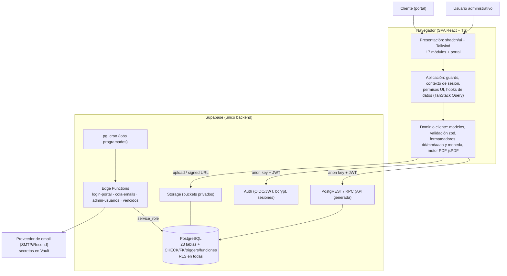
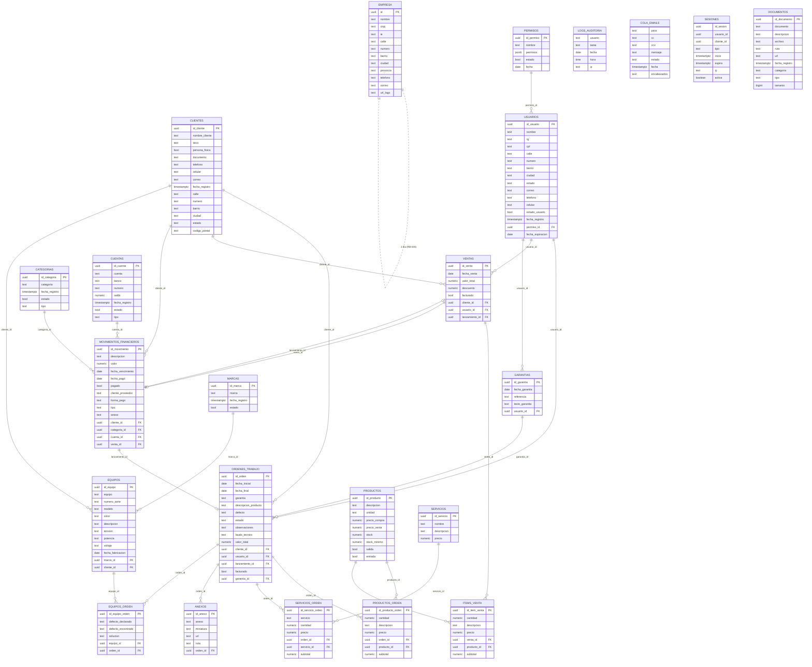
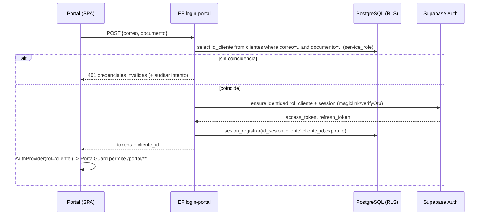
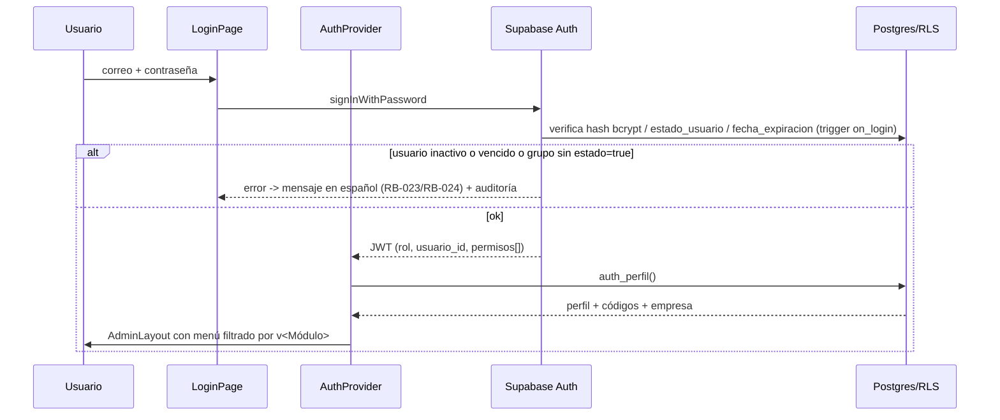
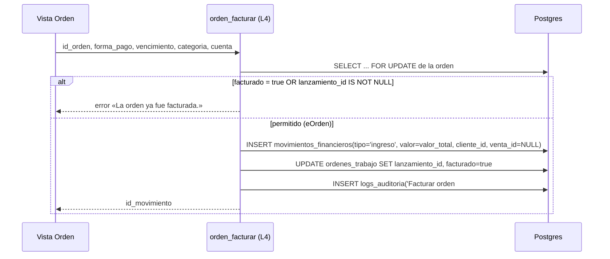
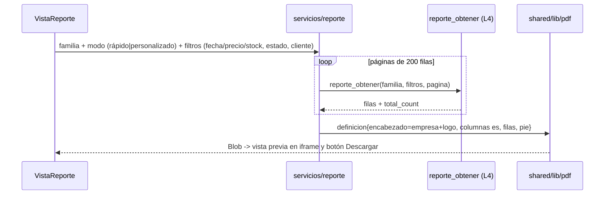

# Arquitectura del Sistema — Sistema Taller

| Campo | Valor |
|---|---|
| Proyecto | Sistema Taller (PROJECT-001) |
| Tarea | TASK-0003 — Architecture Design |
| Autor | AG-005 Software Architect |
| Fecha | 2026-11-05 |
| Versión | 1.0 |
| Fuente de verdad | `docs/requirements/SOURCE_PROMPT.md` (SP) |
| Insumos | `FUNCTIONAL_REQUIREMENTS.md` v2.0 (RF-001…RF-082), `BUSINESS_RULES.md` v2.0 (RB-001…RB-036), `NON_FUNCTIONAL_REQUIREMENTS.md` v2.0 (RNF-*), `USER_STORIES.md` v2.0 (HU-001…HU-048) |
| Estado | **Propuesta de arquitectura completa; lista para revisión de AG-001/AG-004.** 7 puntos escalados (§16). Ninguno bloquea el inicio de la capa de datos, salvo E-01 (stock) y E-02 (proveedor de email), que bloquean los módulos Productos/Órdenes/Ventas y Cola de emails respectivamente. |
| Stack obligatorio | React + TypeScript + Tailwind CSS + shadcn/ui + Supabase (PostgreSQL, Auth, Storage, RLS) `[CONFIRMADA — SP §STACK]` |

---

## 1. Objeto y alcance

Este documento define la arquitectura técnica de "Sistema Taller": estilo arquitectónico, asignación de responsabilidades por capa, estructura de módulos frontend, modelo físico de datos y su seguridad (RLS), ubicación de la lógica de negocio, flujos de datos, despliegue y estrategia de pruebas.

**Límites de alcance heredados de SP (no negociables en esta tarea):**

- Los **17 módulos obligatorios** se conservan con el nombre y la numeración de SP. No se agrega, fusiona ni renombra ningún módulo.
- Las **23 tablas** del modelo SP (`clientes`, `productos`, `servicios`, `ordenes_trabajo`, `productos_orden`, `servicios_orden`, `ventas`, `items_venta`, `garantias`, `movimientos_financieros`, `categorias`, `cuentas`, `anexos`, `documentos`, `marcas`, `equipos`, `equipos_orden`, `usuarios`, `permisos`, `empresa`, `logs_auditoria`, `cola_emails`, `sesiones`) existen exactamente con esos nombres y sus relaciones.
- UI en español; fechas `dd/mm/aaaa`; importes con 2 decimales; patrones de tablas, formularios, modales y paginación.
- Nada de lo que `BUSINESS_RULES.md` §7 declara explícitamente "no incluido" se introduce aquí (facturación fiscal, anulaciones, máquina de estados restrictiva, desfacturar, multi-empresa, reservas de stock, backup funcional, etc.).

Toda decisión de esta arquitectura está etiquetada:

| Etiqueta | Significado |
|---|---|
| `[DECISIÓN]` | Elección de arquitectura con ADR asociado |
| `[Heredada]` | Impuesta por SP o por RF/RB/RNF ya aprobados |
| `[Inferida]` | Detalle no especificado; opción más simple y consistente (SP, párrafo final) |
| `[Escalado]` | Brecha que requiere aprobación de AG-001/AG-004 (§16) |

---

## 2. Mapa de trazabilidad de esta documentación

```
SP (SOURCE_PROMPT) ──► RF/HU/RB/RNF (TASK-0001) ──► Arquitectura (este documento)
                                                      ├─ ARCHITECTURE.md        (visión, capas, datos, flujos, seguridad, NFR)
                                                      ├─ ADR.md                 (20 decisiones numeradas ADR-001…ADR-020)
                                                      └─ COMPONENT_DIAGRAM.md   (diagramas de componentes y matriz módulo→artefactos)
                                                    ◄── cada sección cita RF-xxx / RB-xxx / RNF-xxx / HU-xxx / ADR-nnn
```

Cada sección de este documento declara los IDs que satisface; cada ADR declara los RF/RB/RNF que justifica; `COMPONENT_DIAGRAM.md` contiene la matriz de trazabilidad operativa **módulo → ruta → componente → tabla → RPC → código de permiso → RF/HU**.

---

## 3. Estilo arquitectónico y vista de contenedores

### 3.1 Estilo elegido `[DECISIÓN — ADR-001]`

**SPA (React + TypeScript) sin backend propio, sobre BaaS Supabase, con "lógica dura" en la base de datos (PostgreSQL: constraints, triggers, funciones RPC) y procesos asíncronos en Supabase Edge Functions.**

Justificación en una línea por capa:

- El stack exigido por SP es exactamente ese; cualquier backend Node/Python propio violaría RNF-M-01 ("No se introducen frameworks backend propios").
- Las reglas duras (stock, facturación única, totales, permisos) requieren **atomicidad** (RNF-A-01) que solo puede garantizarse dentro de la transacción de Postgres; una capa intermedia propia no aporta valor y sí riesgo de inconsistencia.
- El procesamiento asíncrono (cola de emails, vencidos) necesita credenciales que **jamás** pueden estar en el bundle (RB-036 / RNF-S-07) → Edge Functions server-side.

### 3.2 Diagrama de contenedores



**Reglas de comunicación**

| # | Regla | Satisface |
|---|---|---|
| C-1 | El bundle solo conoce `VITE_SUPABASE_URL` y la `anon key`. Nada de `service_role` ni secretos SMTP en el cliente. | RB-036, RNF-S-07 |
| C-2 | Toda lectura/escritura de datos pasa por PostgREST (tablas o RPC) **con el JWT del usuario**; RLS decide. | RB-031, RNF-S-02 |
| C-3 | Operaciones compuestas (línea+stock, facturar, limpiar cola) se invocan **solo** como RPC transaccional; nunca como secuencia de llamadas desde el cliente. | RB-002/003/004, RNF-A-01 |
| C-4 | Los procesos con privilegios elevados viven en Edge Functions (un único punto con `service_role`). | RB-036, RNF-A-02 |
| C-5 | Portal y panel son **dos árboles de aplicación distintos** con tipos de sesión incompatibles. | RB-032, RNF-S-03 |

---

## 4. Stack tecnológico y justificación

Versión instalada leída de `package.json` (repo actual); no se introducen librerías UI que dupliquen shadcn (RNF-M-01).

| Tecnología | Versión | Rol | Justificación / alternativa descartada | ADR |
|---|---|---|---|---|
| React | 19.3 | Vista/componentes | Impuesto por SP; React 19 ya en el repo; soporta `use`/Actions que simplifican formularios | ADR-002 |
| TypeScript | 7.0 (strict) | Todo el código de aplicación | Impuesto por SP; tipos generados desde el esquema (`supabase gen types`) dan seguridad en las 23 tablas | ADR-002, ADR-010 |
| Vite | 5.4 | Build/dev | Único builder viable para SPA TS moderna; alias `@` → `src` ya configurado; code-splitting por ruta (RNF-P-03) | ADR-002 |
| Tailwind CSS | 4.3 | Estilos | Impuesto por SP; v4 con `@tailwindcss/vite`, sin postcss extra | ADR-011 |
| shadcn/ui | 4.23 (`@base-ui/react`) | Componentes de panel | Impuesto por SP; el repo ya tiene `button, input, label, select, table, dialog, card, badge, textarea`; añade `pagination`, `tabs`, `command`, `popover`, `sonner` | ADR-011 |
| Supabase JS | 2.119 | Auth, PostgREST, Storage | Único backend del stack; JWT + RLS nativos | ADR-003/004/013 |
| react-router-dom | 7.18 | Rutas del panel y del portal | SPA multi-módulo con guards y layout anidado | ADR-002 |
| jsPDF (+`jspdf-autotable`) | 4.2 (jspdf) | Reportes e impresiones | SP permite jsPDF **o** react-pdf; jsPDF genera el PDF desde datos y lo descarga/abre sin visor de terceros, y es la ya instalada. `react-pdf` está orientado a *renderizar* PDFs, no a producirlos | ADR-012 |
| TanStack Query | 5.x (a añadir) | Cache/invalidación de datos list | RNF-U-03 (paginación server-side) + RNF-P-01 exigen caché, estado de página y revalidación tras RPC; sin él cada pantalla reimplementa loading/errores | ADR-010 |
| zod | 3.x (a añadir) | Validación compartida L1 | RB-033 pide validar en ambos extremos: el mismo schema se usa en formularios y como especificación de los `CHECK` documentados | ADR-019 |
| React Hook Form | 7.x (a añadir) | Formularios controlados | Integración natural con zod + shadcn (`FormField`), necesaria en órdenes/ventas con líneas dinámicas | ADR-019 |
| Vitest + Testing Library + Playwright | 4.x / 1.x | Pruebas unitarias y E2E | RNF-M-02; `npm run test` ya definido | ADR-018 |
| pgTAP / `supabase test db` | — | Pruebas de RLS y funciones SQL | Único modo de verificar RB-031 por tabla/rol (RNF-S-02) | ADR-018 |

**Prohibido explícitamente por la arquitectura** (para cumplir RNF-M-01 y SP): Express/Fastify/NestJS propio, ORM con migraciones fuera de `supabase/migrations`, librerías de componentes (MUI, AntD, Chakra), librerías de estado global (Redux/Zustand: TanStack Query + Context son suficientes), i18next (el idioma es único: español).

---

## 5. Capas y modelo de aplicación de reglas (L1–L5)

Se adopta el modelo de capas de aplicación de reglas de `BUSINESS_RULES.md` §1, asignándole artefactos concretos:

| Capa | Artefacto físico | Responsabilidad | Ejemplo |
|---|---|---|---|
| **L1 UI** | `src/features/**` + `zod` | Comodidad, mensajes en español, ocultar acciones sin permiso | `clientes.schema.ts` |
| **L2 Postgres** | `supabase/migrations/*.sql` (CHECK, UNIQUE, FK `ON DELETE RESTRICT`, índices, triggers) | Invariantes absolutas | `CHECK (estado IN ('Presupuesto','Abierta','En Proceso','Finalizado','Cancelado','Aguardando Piezas'))` (RB-010) |
| **L3 RLS** | `create policy` por tabla + funciones helper | Autorización real por tipo de sesión y código de permiso | `tiene_permiso('vCliente')` |
| **L4 RPC** | `create function public.*` (`SECURITY DEFINER`) + `select` desde el cliente | Operaciones compuestas atómicas | `orden_facturar(id)` |
| **L5 Job/EF** | `supabase/functions/*` + `pg_cron` | Asíncrono con secretos | `cola-emails-procesar` |

**Principio rector:** una regla nunca vive solo en L1. L1 es espejo de L2/L4 (mismas constantes en `shared/domain/reglas.ts` generadas desde un único archivo, con pruebas que verifican la coincidencia — RNF-S-04).

Distribución de los RB según la matriz de `BUSINESS_RULES.md` §6 → esta arquitectura materializa: RB-002/003/004/017/018/019/020/021 en **L4**; RB-010/014/015/019/020/022/030 en **L2**; RB-006/031/032 en **L3**; RB-007/008/005 en **L1/L4 (motor PDF)**; RB-009/028 en **L2 (trigger) + L4**; RB-025/026 en **L2 (vista/función)**; RB-023/024/029 en **L3+L4**; RB-001/033/034/035/036 en proceso y políticas transversales (§12).

---

## 6. Arquitectura del frontend

### 6.1 Estructura de carpetas objetivo `[DECISIÓN — ADR-002]`

Arquitectura por **características verticales (feature-sliced)**: una carpeta por cada uno de los 17 módulos de SP, con API pública (`index.ts`) y sin importaciones internas cruzadas entre features.

```
src/
  main.tsx
  app/
    routes.tsx                  # mapa de rutas único (panel + portal)
    providers.tsx               # SupabaseProvider, AuthProvider, PermisoProvider, QueryClientProvider, Toaster
    guards/
      AdminGuard.tsx            # RB-035: sesión tipo 'administrador'
      PortalGuard.tsx           # RB-035: sesión tipo 'cliente'
      PermisoGuard.tsx          # RF-006: exige código v<Módulo> en la ruta
  layouts/
    AdminLayout.tsx             # sidebar + topbar responsivos (RNF-U-02)
    PortalLayout.tsx            # layout del portal, sin menú administrativo
  features/
    autenticacion-admin/        # M1
    panel-principal/            # M2
    clientes/                   # M3   (incluye sub-recurso equipos/marcas)
    productos/                  # M4
    servicios/                  # M5
    ordenes-trabajo/            # M6   (incluye equipos_orden, anexos, enviar por correo, imprimir, facturar)
    ventas/                     # M7
    garantias/                  # M8
    financiero/                 # M9   (incluye categorias y cuentas como pestañas internas)
    archivos-documentos/        # M10
    usuarios/                   # M11
    permisos/                   # M12
    informes-reportes/          # M13
    auditoria/                  # M14
    cola-emails/                # M15
    portal-cliente/             # M16
    configuracion-empresa/      # M17
  shared/
    supabase/client.ts          # singleton createClient (anon key)
    supabase/database.types.ts  # generado con `supabase gen types typescript` (23 tablas + RPC)
    components/                 # DataTablePaginado, FiltroBar, ModalFormulario, Autocomplete,
                                # ConfirmDialog, CampoMoneda, CampoFecha, RangoFechas, EmptyState,
                                # ErrorState, PermissionGate, PageHeader, SubirArchivo
    domain/                     # tipos de negocio, constantes (estados orden, situaciones, códigos permiso)
    lib/                        # formato.ts (dd/mm/aaaa, moneda), precio.ts, permisos.ts, storage.ts, pdf/
    hooks/                      # useAuth, useSesion, usePermiso, usePaginacion, useAutocompletado
```

Estructura interna homogénea de cada feature:

```
features/<modulo>/
  index.ts                 # API pública: rutas, enlaces del menú (registro), tipos compartidos
  pages/                   # pantallas (listado / ficha / formulario impreso)
  components/              # componentes propios del módulo
  data/                    # <entidad>.repositorio.ts (queries/RPC) + <entidad>.queries.ts (hooks TanStack)
  model/                   # <entidad>.schema.ts (zod) + reglas de presentación
  types.ts
```

### 6.2 Mapa de rutas (panel administrativo)

Rutas existentes en el prototipo conservadas; se agregan las de ficha/detalle e impresión y el portal estructurado. `[Heredada: 17 módulos SP]`

| # | Módulo (SP) | Ruta(s) | Acción | Código de permiso exigido en la ruta |
|---|---|---|---|---|
| M1 | Autenticación administrativa | `/login`, `/logout` | pública / guardada | — |
| M2 | Panel principal | `/` | resumen | sesión admin válida |
| M3 | Clientes | `/clientes`, `/clientes/:id` | listado/ficha | `vCliente` |
| M4 | Productos | `/productos`, `/productos/:id` | listado/ficha | `vProducto` |
| M5 | Servicios | `/servicios` | listado/ficha modal | `vServicio` |
| M6 | Órdenes de trabajo | `/ordenes`, `/ordenes/:id`, `/ordenes/:id/imprimir` | listado/ficha | `vOrden` |
| M7 | Ventas | `/ventas`, `/ventas/:id`, `/ventas/:id/imprimir` | listado/ficha | `vVenta` |
| M8 | Garantías | `/garantias`, `/garantias/:id/imprimir` | listado/ficha | `vGarantia` |
| M9 | Financiero | `/financiero`, `/financiero/categorias`, `/financiero/cuentas` | listado+filtros | `vMovimiento` |
| M10 | Archivos/Documentos | `/documentos` | listado | `vArchivo` |
| M11 | Usuarios | `/usuarios`, `/usuarios/:id` | listado/ficha | `vUsuario` |
| M12 | Permisos | `/permisos`, `/permisos/:id` | listado/editor | `vPermiso` |
| M13 | Informes/Reportes | `/reportes`, `/reportes/:familia` | generación PDF | `rCliente…rVenta`, `vCliente` para ver listado |
| M14 | Auditoría | `/auditoria` | listado/limpiar | `vAuditoria` |
| M15 | Cola de emails | `/emails` | listado/procesar | `vEmail` |
| M17 | Configuración de empresa | `/empresa` | formulario único | `cEmpresa` |
| M16 | Portal del cliente | `/portal`, `/portal/ingresar`, `/portal/ordenes/:id`, `/portal/compras/:id`, `/portal/cuenta`, `/portal/salir` | privada tipo cliente | sesión `rol='cliente'` |

### 6.3 Gestión de estado y datos `[DECISIÓN — ADR-010]`

- **Estado de servidor** (listados, fichas, totales, panel): TanStack Query. Claves jerárquicas `['clientes', {filtros, pagina}]`, `['ordenes', id]`. Invalidación explícita tras cada RPC: tras `orden_agregar_producto` se invalidan `ordenes:id`, `ordenes:listado`, `productos:listado` (alerta de stock) y `panel`. Cubre RNF-P-01 y RNF-U-03.
- **Estado de sesión**: `AuthContext` (usuario + perfil `usuarios` + set de códigos de permiso + tipo de sesión). Se hidrata con un único RPC `auth_perfil()` y se refresca en `onAuthStateChange`.
- **Estado efímero de formulario**: React Hook Form. Sin store global de aplicación.
- **Repositorios** (`data/*.repositorio.ts`): única capa que conoce el nombre físico de tabla/columnas y las RPC. Los componentes **no** llaman `supabase.from(...)` directamente (a diferencia del prototipo actual, §15). Facilita tipado generado y pruebas con `vi.mock`.
- **Errores**: canal único `shared/lib/errores.ts` que traduce códigos Postgres → mensaje en español (`23505` → «Ese valor ya está registrado.», `23503` → «El registro tiene relaciones asociadas; no puede eliminarse.» (RB-022), `P0001` con `insuficiente_stock` → «Stock insuficiente. Disponible: X.»). Toast (`sonner`) + error inline en el campo.

### 6.4 Permisos en la UI `[DECISIÓN — ADR-006]`

- Registro central `shared/domain/permisos.ts`: 14 módulos cubiertos × 6 actividades = vocabulario **cerrado** de SP (RB-029), con la etiqueta en español de cada código y el módulo al que pertenece.
- `usePermiso('aCliente')` y `<PermissionGate code="dCliente">` leen el set del contexto. El menú lateral se construye filtrando por `v<Módulo>` (RF-009).
- Ocultar **no** autoriza: el mismo código se verifica en RLS (L3) y en la RPC (L4). Prueba automatizada: llamada directa con JWT sin el código → 0 filas / error.

### 6.5 Presentación normalizada `[Heredada RB-007/RB-008]`

- `shared/lib/formato.ts`: `formatoFecha(d) → dd/mm/aaaa`, `parseFecha`, `formatoMoneda(n) → '1.234,56'` + símbolo configurable (ver E-06), `redondear2`. Prohibido renderizar fechas/importes sin estos helpers (RNF-U-05, verificación por lint `no-restricted-syntax`).
- Moneda en `numeric(12,2)`; **nunca** `float` ni conversiones a `number` en cálculos de totales: los totales los calcula Postgres (L4) y llegan ya redondeados.
- Zona horaria única `[Inferida — RNF-C-03]`: `ALTER DATABASE … SET timezone = 'America/Sao_Paulo'` + constante frontend `ZONA_LOCAL`; almacenamiento `timestamptz`; "hoy" para vencidos se calcula en BD.

### 6.6 Motor de documentos/PDF `[DECISIÓN — ADR-012]`

Un único motor `shared/lib/pdf/` usado por los 4 contextos (Informes, orden, venta, garantía, portal — RNF-P-04):

```
documento_pdf.definicion = {
  encabezado():  nombre, CNPJ/IE, dirección, teléfono/correo, logo (empresa)   # RB-005, RF-082
  columnas():    [{ clave, etiqueta_es, ancho, alineacion, formato }]
  filas():       datos ya filtrados/paginados desde BD (nunca select(*) del cliente)
  pie():         página N de M, fecha de emisión, totales si el reporte los tiene
}
```

- `jsPDF` + `jspdf-autotable` con `didDrawPage` para repetir encabezado/pie en cada página (RF-065, RNF-C-02, A4 por defecto).
- Salida: `blob` → vista previa en `<iframe>` (RF-066) o `save()` para descarga. El mismo `blob` se usa en el portal con datos ya restringidos por RLS.
- El logo se toma de Storage (`empresa.url_logo`) descargado como `dataURL` (caché de sesión) para evitar CORS.

### 6.7 Archivos y Storage `[DECISIÓN — ADR-013]`

| Bucket | Contenido | Acceso |
|---|---|---|
| `anexos-orden` | adjuntos de orden (`anexos`) + miniatura `<ruta>.thumb.webp` | privado; políticas por `tiene_permiso('vOrden'/'eOrden')` |
| `documentos` | archivos del módulo Archivos/Documentos | privado; `vArchivo`/`aArchivo` |
| `comprobantes` | `movimientos_financieros.anexo` | privado; `vMovimiento`/`eMovimiento` |
| `logos` | logo de empresa | lectura pública (necesario para el PDF), escritura `cEmpresa`/`eEmpresa` |

Convención de objeto: `<id-entidad>/<uuid-v4>-<nombre-sanitizado>`. Se persisten `ruta` = `bucket/objectPath` (fuente de verdad) y `url` = URL **firmada** de 60 min regenerada al listar/descargar (RF-025, RF-050, RF-052, RF-048). Miniaturas generadas en el cliente con `<canvas>` (máx. 256 px, WebP) para no depender de librerías de imagen en Edge Runtime. Sanitización de nombre de archivo (RB-034) y límite de tamaño (20 MB, `[Inferida]`, configurable).

---

## 7. Arquitectura de datos

### 7.1 Convenciones físicas `[DECISIÓN — ADR-017]`

1. Nombres de tablas y columnas **en español**, literalmente los de SP, con tres ajustes técnicos obligados (sin cambiar la semántica de negocio):
   - `usuarios`: SP pide `estado` (booleano activo/inactivo) **y** `estado` (provincia, dentro de la dirección) → colisión real de nombre (es el defecto que impide aplicar la migración actual, §15). Solución: `estado text` (región/provincia, dirección) + `estado_usuario boolean` (activo/inactivo). En la UI ambos se muestran con sus etiquetas SP: «Estado» (dirección) y «Estado (activo/inactivo)» (RF-056).
   - `documentos.tamaño` → columna física `tamanio` (sin `ñ`, evita comillas en SQL y errores de encoding); etiqueta UI «Tamaño».
   - `usuarios.contraseña` → la **no** se almacena en `public.usuarios`: el hash lo custodia `auth.users.encrypted_password` (bcrypt) (ADR-003). La "columna" de SP queda satisfecha por el mecanismo de Auth; ninguna ruta expone el hash (RF-002, RNF-S-01).
2. PK: `id_<tabla singular>` exatamente como SP (`id_cliente`, `id_orden`, …), tipo `uuid default gen_random_uuid()`.
3. FK: `ON DELETE RESTRICT` por defecto (RB-022); `ON DELETE CASCADE` solo en tablas línea sin identidad propia: `productos_orden`, `servicios_orden`, `items_venta`, `anexos`, `equipos_orden` (hijos directos del documento padre) `[Inferida]`.
4. Dinero: `numeric(12,2)` (RB-008); cantidades `numeric(12,2)` (unidades puede ser fraccionario: `unidad` text lo admite) `[Inferida]`.
5. Fechas: `date` para fechas de negocio (vencimiento, expiración, `fecha_inicial/final`, `fecha_venta`); `timestamptz` para registros (`fecha_registro`, `cola_emails.fecha`); `logs_auditoria.fecha date` + `hora time` según SP (RB-028).
6. Enums: `text` + `CHECK` con los valores literales de SP (no `TYPE enum` propio para no bloquear renombra-mientos ni `pg_dump` posteriores):
   - `ordenes_trabajo.estado IN ('Presupuesto','Abierta','En Proceso','Finalizado','Cancelado','Aguardando Piezas')` (RB-010)
   - `movimientos_financieros.tipo IN ('ingreso','egreso')`; `categorias.tipo`, `cuentas.tipo` ídem
   - `cola_emails.estado IN ('pendiente','enviando','enviado','fallido')` (RB-015)
7. `permisos.permisos`: **JSONB** con array de códigos (`["aCliente","vOrden"]`). SP admite coma o JSON; JSONB permite `?`/`@>` en RLS sin `LIKE` y sin tablas auxiliares nuevas (RF-061, `[Inferida]`).
8. `cola_emails.encabezados`: `text` por SP; se usa un JSON serializado (incluye `asunto`, `intentos`, `ultimo_error`) para no agregar columnas de negocio fuera del modelo (ADR-014).

### 7.2 ERD de las 23 tablas (obligatorio RNF-M-05)



Relaciones verificadas contra SP §MODELO DE DATOS: **23 tablas, 0 añadidas** (`sesiones` es la tabla 23 exigida por SP), **0 eliminadas**, **0 renombradas** en el plano lógico.

### 7.3 Constraints, índices y vistas `[Inferida — RNF-E-02]`

| Tipo | Artefacto | Regla/RF |
|---|---|---|
| UNIQUE | `clientes(documento) WHERE documento IS NOT NULL`; `usuarios(correo)`; `clientes(correo, documento)` (par de acceso al portal, sin duplicados: RB-012 `[Inferida]`) | RF-054, RF-075 |
| CHECK | `productos CHECK (stock >= 0 AND stock_minimo >= 0 AND precio_compra >= 0 AND precio_venta >= 0)`; `movimientos CHECK (valor > 0)`; `ventas CHECK (descuento >= 0 AND valor_total >= 0)`; `pagado = true → fecha_pago IS NOT NULL`; `lineas CHECK (cantidad > 0 AND precio >= 0)`; `empresa CHECK (id = (SELECT id FROM empresa LIMIT 1))` → implementado como trigger `empresa_unica` (RB-030) | RB-008/014/019/020/030 |
| Índice parcial | `CREATE UNIQUE INDEX orden_lanzamiento_uno ON ordenes_trabajo(lanzamiento_id) WHERE lanzamiento_id IS NOT NULL`; ídem ventas | RB-003/004 |
| Búsqueda | `clientes`: trigram/btree en `lower(nombre_cliente)`, `documento`, `lower(correo)`; `productos/servicios/garantias`: `lower(descripcion|nombre|referencia)` | RF-011, RF-029, RNF-U-04 |
| Filtros | `movimientos(fecha_vencimiento, pagado, tipo, categoria_id, cuenta_id)`; `ordenes(estado, fecha_inicial, cliente_id, facturado)`; `ventas(fecha_venta, cliente_id)`; `logs_auditoria(fecha, usuario)`; `cola_emails(estado, fecha)` | RF-043/044/064, RF-007, RF-068 |
| Vista | `v_movimientos_situacion`: añade `situacion` (realizado/atrasado/previsto/pendiente) y `vencido` según RB-025/RB-026 | RF-044, RF-046 |
| Vista | `v_stock_alerta`: productos con `stock < stock_minimo` | RF-016, RF-007 |
| Vista | `v_cliente_vinculos`: conteo de órdenes/ventas/movimientos/equipos por cliente (ficha y bloqueo de borrado) | RF-013, RB-022 |

Todas las vistas se crean `security invoker` (heredan RLS) y se exponen también como funciones RPC cuando el portal las necesita (ADR-004).

---

## 8. Lógica de negocio en base de datos (catálogo de funciones)

`[DECISIÓN — ADR-007]` — funciones `SECURITY DEFINER` con `SET search_path = public, pg_temp`, verificando internamente el permiso del llamante (defensa en profundidad: aunque la política RLS de escritura permita, la RPC comprueba el código).

| Función RPC | Efecto atómico | Regla |
|---|---|---|
| `auth_perfil()` | devuelve usuario + grupo + set de códigos + tipo de sesión | RF-006/009 |
| `login_portal(p_correo, p_documento)` | valida par contra `clientes`, emite sesión de cliente (vía EF) | RF-075, RB-012 |
| `sesion_registrar(p_id_sesion, p_tipo, p_usuario, p_cliente, p_expira, p_ip)` / `sesion_cerrar(p_id)` / `sesion_purgar()` | materializa `sesiones` | RF-005, RF-003/004 |
| `orden_crear(p_cliente, p_usuario, p_campos…) -> uuid` | alta de cabecera + auditoría | RF-020 |
| `orden_agregar_producto(p_orden, p_producto, p_cantidad, p_precio)` | snapshot línea + `stock -= cantidad` + recalcular total + log | RB-002/017/018/021 |
| `orden_quitar_producto(p_linea)` | `stock += cantidad` + baja línea + total + log | RB-002/018 |
| `orden_cambiar_cantidad_producto(p_linea, p_cantidad)` | ajusta delta de stock + subtotal + total | RF-018 CA |
| `orden_agregar_servicio` / `orden_quitar_servicio` | línea + total (sin stock) | RF-023 |
| `orden_recalcular_total(p_orden)` | `valor_total = Σ productos + Σ servicios` (trigger en alta/baja de línea) | RB-018, RF-024 |
| `orden_cambiar_estado(p_orden, p_estado)` | valida enum + `fecha_final` al pasar a Finalizado + log | RF-021 |
| `orden_facturar(p_orden, p_forma_pago, p_fecha_vencimiento, p_categoria, p_cuenta)` | movimiento `ingreso` + `lanzamiento_id` + `facturado=true` + log; rechaza si ya facturada | RB-003/027, RF-028 |
| `venta_*` (`venta_agregar_item`, `venta_quitar_item`, `venta_recalcular_total`, `venta_facturar`) | ídem con `descuento` y vínculo doble `venta_id`/`lanzamiento_id` | RB-004/019/027, RF-032…037 |
| `movimiento_marcar_pagado(p_id, p_fecha_pago)` | `pagado=true` + `fecha_pago` + log | RB-014, RF-041 |
| `financiero_listar(p_periodo, p_situacion, p_desde, p_hasta, p_desde_id, p_hasta_id)` | filas paginadas con situación | RF-043/044/046 |
| `financiero_totales(p_periodo, p_situacion, …)` | ingresos, egresos, saldo del período | RF-045 |
| `panel_resumen()` | órdenes abiertas por estado, stock bajo, últimas 5 ventas, movimientos pendientes/vencidos | RF-007 |
| `busqueda_clientes(q)` / `busqueda_productos(q)` / `busqueda_servicios(q)` / `busqueda_usuarios(q)` / `busqueda_garantias(q)` | top 15 para autocompletado | RF-029, RNF-U-04 |
| `reporte_obtener(p_familia, p_filtros jsonb, p_pagina, p_por_pagina)` | filas paginadas para PDF (rápido/personalizado) | RF-062…064, RNF-P-02 |
| `auditar(p_usuario, p_tarea)` + trigger genérico `tg_auditar` | insert `logs_auditoria` con `fecha/hora` locales e `ip` tomada de `current_setting('request.headers')` | RB-009/028, RF-067 |
| `limpiar_logs(p_desde)` | descarga previa → borrado → **auto-log** antes de borrar | RF-069 |
| `cola_encolar_email(p_para, p_cc, p_cco, p_mensaje, p_encabezados)` | alta `pendiente` | RF-070, RF-026 |
| `cola_reintentar(p_ids)` / `cola_eliminar(p_ids)` | `fallido → pendiente`; bajas | RF-073/074 |
| `cliente_actualizar_cuenta(p_campos)` (portal) | edición propia; **rechaza** cambio de `correo`/`documento` | RF-079, OQ-05 |
| `portal_detalle_orden(p_id)` / `portal_detalle_venta(p_id)` | documento completo (líneas, empresa, técnico, garantía) solo si `cliente_id = cliente_actual()` | RF-077/078, RB-032 |
| `empresa_obtener()` / `empresa_guardar(p_datos)` | registro único + logo | RF-081/082, RB-030 |

**Protección de columnas derivadas** `[Inferida — RB-002]`: `productos.stock` no puede actualizarse directamente desde el cliente (RLS `update` de esa columna denegada + trigger `tg_stock_no_directo` que exige el GUC transaccional `app_permite_stock_write = 'on'` que solo fijan las RPC de líneas/entrada de inventario del catálogo). Así, el invariante de stock es verificable por prueba de propiedad (RNF-M-02).

---

## 9. Autenticación, sesiones y permisos

### 9.1 Dos reinos de sesión `[DECISIÓN — ADR-003 y ADR-004]`

| | Panel administrativo | Portal del cliente |
|---|---|---|
| Identidad | `auth.users` creado por la EF `admin-usuarios` (módulo Usuarios) con correo único | `auth.users` de tipo portal, alias derivado, `app_metadata.rol='cliente'`, `app_metadata.cliente_id` |
| Credenciales | correo + contraseña (bcrypt en Auth) | correo + `documento` del cliente (validado por EF `login-portal`) |
| Claims clave | `rol='administrador'`, `usuario_id` | `rol='cliente'`, `cliente_id` |
| RLS | políticas por código de permiso | políticas `cliente_id = cliente_actual()`; **cero** acceso a datos ajenos |
| Sesión DB | fila en `public.sesiones` (`tipo='administrador'`) | fila en `public.sesiones` (`tipo='cliente'`) |
| Cierre | `auth.signOut()` + `sesion_cerrar()` | ídem |
| Vigencia `[Inferida — RNF-S-08]` | access 60 min + refresh silencioso; idle 12 h → re-login | ≤ 24 h, sin refresh prolongado |

Flujo de alta de identidades (evita "inventar" un sistema de tokens):

- `usuarios` (tabla SP) es el **perfil**; `auth.users` es la **identidad**. FK lógica por `correo` único y `id_usuario = auth.users.id` (se fija al crear la identidad con la EF). Ninguna contraseña viaja por el cliente más allá del envío del formulario de alta/cambio.
- Un cliente con `correo` y `documento` obtiene identidad de portal de forma perezosa: la EF `login-portal` valida el par contra `clientes` (service_role), y si es correcto, **crea la identidad si no existe** (`admin.generateLink` + `verifyOtp` para emitir sesión) o emite una nueva sesión para la existente. La tabla `clientes` sigue siendo la fuente de datos del cliente; `auth.users` solo porta credenciales.
- Compatibilidad con RB-012 y RF-075: un par que no coincide → error «Correo o documento no coinciden con ningún cliente registrado.» (genérico, sin revelar existencia — `[Recomendada]`).



### 9.2 Motor de permisos (L3) `[DECISIÓN — ADR-006]`

Funciones helper (`STABLE`, `SECURITY DEFINER`, sin fuga de datos):

```sql
public.rol_sesion()      -- 'administrador' | 'cliente' | null  (desde auth.jwt()->'app_metadata'->>'rol')
public.usuario_actual()  -- uuid desde claim usuario_id
public.cliente_actual()  -- uuid desde claim cliente_id
public.es_administrador() / public.es_cliente()
public.tiene_permiso(codigo text)  -- existe fila: usuarios ⋈ permisos con estado=true,
                                   -- fecha_expiracion no vencida y permisos ? codigo
```

Plantilla de política por tabla (ejemplo `clientes`, RF-010/RF-013/RF-079/RB-031/RB-032):

```sql
create policy clientes_select on clientes for select to authenticated using (
     (es_administrador() and tiene_permiso('vCliente'))
  or (es_cliente() and id_cliente = cliente_actual())
);
create policy clientes_insert on clientes for insert to authenticated with check (es_administrador() and tiene_permiso('aCliente'));
create policy clientes_update on clientes for update to authenticated using (
     (es_administrador() and tiene_permiso('eCliente'))
  or (es_cliente() and id_cliente = cliente_actual() and row (correo, documento) =
      (select row(correo, documento) from clientes c where c.id_cliente = cliente_actual()))
) with check (es_administrador() or id_cliente = cliente_actual());
create policy clientes_delete on clientes for delete to authenticated using (es_administrador() and tiene_permiso('dCliente'));
```

- **Todas las 23 tablas** reciben políticas (RNF-S-02 exige RLS activado sobre las 23). `logs_auditoria` y `cola_emails`: `select` admin con `vAuditoria`/`vEmail`; `insert` solo por trigger/RPC (definer); `delete` con `dAuditoria`/`dEmail`.
- `sesiones`: `select` solo propio + admin `vUsuario`; `insert/update` solo funciones definer y EF.
- Escalada de costo: `tiene_permiso` se evalúa en el `jwt` → se cachea el set de códigos en `auth.users.raw_app_meta_data.permisos` al iniciar sesión y al cambiar el grupo (EF `admin-usuarios` / `permisos_guardar` propagan). Así RLS es O(1) por consulta y se cumple RNF-P-01 (RB-006/RF-006 verificados con matriz automatizada).

### 9.3 Conjunto mínimo auditado (lista cerrada de "acciones relevantes")

Aprobada por RB-009/CA1 de RF-067 y adoptada literalmente: login/logout admin y portal; alta/edición/baja de clientes, productos, servicios, órdenes, ventas, garantías, movimientos, documentos, usuarios, permisos, empresa; facturar orden/venta; cambio de estado de orden; ajuste de stock por líneas; envío/reintento/borrado de email; limpieza de logs; denegaciones de permiso y logins fallidos (RNF-S-09).

---

## 10. Flujos de datos principales

### 10.1 Login administrativo y arranque del menú (RF-001…009)



### 10.2 Alta de orden con productos y servicios (RF-020…024, RF-029, RB-002)

```mermaid
sequenceDiagram
  participant V as Vista OrdenDetalle
  participant R as ordenes.repositorio
  participant RPC as RPC L4
  participant DB as Postgres
  V->>V: autocompletado (busqueda_productos) -> snapshot nombre/precio
  V->>R: agregarProducto(orden, producto, cantidad, precio)
  R->>RPC: orden_agregar_producto(...)
  RPC->>DB: LOCK productos FOR UPDATE; CHECK stock >= cantidad (E-01)
  RPC->>DB: INSERT productos_orden (subtotal = round(cantidad*precio,2))
  RPC->>DB: UPDATE productos SET stock = stock - cantidad (GUC permitido)
  RPC->>DB: UPDATE ordenes_trabajo SET valor_total = (Σ productos + Σ servicios)
  RPC->>DB: INSERT logs_auditoria (usuario, tarea, fecha, hora, ip)
  RPC-->>R: ok (nuevo total, stock actual)
  R-->>V: invalidación de ['ordenes',id], ['productos'], ['panel']
  V->>V: si stock < stock_minimo -> Badge "Stock bajo" (RF-016)
```

### 10.3 Facturar orden (RF-028, RB-003/027) — y análogo para venta (RF-035, RB-004)



### 10.4 Enviar orden por correo → cola → envío (RF-026, RF-070…073)

```mermaid
sequenceDiagram
  participant V as Vista Orden
  participant RPC as orden_enviar_email (L4)
  participant Q as cola_emails
  participant CRON as pg_cron
  participant EF as EF cola-emails-procesar
  participant SMTP as Proveedor email
  V->>RPC: id_orden (destinatario preseleccionado = clientes.correo, editable)
  RPC->>Q: INSERT estado='pendiente', encabezados={asunto, intentos:0}
  RPC->>Q: (adjunta PDF/link firmado según plantilla simple)
  RPC-->>V: ok + auditoría (RF-067)
  CRON->>EF: cada 2 min
  EF->>Q: UPDATE ... SET estado='enviando' WHERE estado='pendiente' RETURNING (SKIP LOCKED, lote 20)
  EF->>SMTP: enviar
  alt éxito
    EF->>Q: estado='enviado'
  else fallo
    EF->>Q: estado='fallido', intentos+1 (en encabezados)
  end
  Note over EF,Q: RB-015 transiciones válidas; RNF-A-02 el fallo no rompe el negocio
```

### 10.5 Reporte PDF (RF-062…066, RB-005)



### 10.6 Carga de anexo de orden (RF-025, RF-050)

`seleccionar archivo → validar tipo/tamaño → thumbnail canvas → upload bucket `anexos-orden/<id_orden>/` → INSERT anexos(anexo, miniatura, ruta, url=firma temporal) → auditoría → refresh ficha` (RF-052 descarga con URL firmada regenerada).

---

## 11. Jobs y Edge Functions

| Artefacto | Disparo | Trabajo | Reglas |
|---|---|---|---|
| EF `login-portal` | HTTP (anon) | validar correo+documento, emitir sesión cliente | RF-075, RB-012, RB-036 |
| EF `admin-usuarios` | invocación autenticada con `aUsuario/eUsuario/dUsuario` | crear/actualizar/dar baja identidades + propagar grupo de permisos al JWT | RF-054…058, RB-023 |
| EF `cola-emails-procesar` | `pg_cron` cada 2 min | lote `pendiente→enviando→enviado/fallido` con `FOR UPDATE SKIP LOCKED` | RB-015, RNF-A-02 |
| EF `cola-emails-reintentar` | `pg_cron` cada 15 min | `fallido` con `intentos < 3` → `pendiente` | RF-073 |
| EF `vencidos-deteccion` | `pg_cron` diario | marca/consulta de vencidos + panel; sin mutación de negocio (RB-025 se resuelve en `v_movimientos_situacion`) | RF-046 |
| EF `sesiones-mantenimiento` | `pg_cron` horario | `sesion_purgar()` (expiradas/inactivas) | RF-005/003 |

Secretos (SMTP, `service_role`) solo en Vault/Environment del proyecto Supabase; nunca en `.env` del bundle (RNF-S-07).

---

## 12. Seguridad transversal (SP §SEGURIDAD íntegra)

| Regla SP / RB | Mecanismo concreto | Verificación |
|---|---|---|
| RLS (RB-031) | 23 tablas con `ENABLE ROW LEVEL SECURITY` + políticas por rol/código (§9.2); RLS forzado también en vistas (`security_invoker`) | suite pgTAP por tabla/rol |
| Roles separados (RB-032) | claims `rol` incompatibles; políticas con rama `es_cliente()`/`es_administrador()`; el portal no tiene ninguna política que permita `rol='administrador'` en tablas ajenas | test: JWT cliente sobre `usuarios` → 0 filas |
| Validación doble (RB-033) | schema `zod` en L1 + `CHECK`/FK/RPC en L2/L4 con la misma tabla de reglas en `shared/domain/reglas.ts` | API directa con datos inválidos → rechazo |
| Sanitización (RB-034) | PostgREST parameters (sin SQL concatenado); React escapa la salida; prohibido `dangerouslySetInnerHTML` (regla de lint); nombres de archivo sanitizados; `mailto`/HTML de email generado desde plantilla con `escapeHtml` | fuzzing XSS/SQL |
| Rutas privadas (RB-035) | `AdminGuard`/`PortalGuard` + verificación server-side por RLS; redirección al login correspondiente | acceso directo sin token |
| Sin credenciales en el frontend (RB-036) | solo `VITE_SUPABASE_URL` + anon key; `service_role` en EF; `.env` ignorado (`.gitignore`), `.env.example` versionado | gitleaks + grep del bundle |
| Contraseñas (RF-002) | bcrypt gestionado por Supabase Auth; la API de perfiles no devuelve el hash (`database.types.ts` excluye `auth schema`) | inspección de respuestas |
| Sesiones (RF-003/005) | tabla `sesiones` + expiración del JWT + `sesion_cerrar`/`sesion_purgar` | expiración simulada |
| Auditoría (RF-067) | trigger genérico + RPC `auditar` (no confiado a la UI); IP desde `request.headers->>'x-forwarded-for'` | por acción, fila con 5 campos |

---

## 13. Rendimiento, capacidad y confiabilidad

| RNF | Mecanismo arquitectónico |
|---|---|
| RNF-P-01 (≤2 s P95) | RPC paginadas con `.range()`/`LIMIT`, índices de §7.3, cacheo de permisos en el JWT, TanStack Query (staleTime 30 s en listados) |
| RNF-P-02 (queries acotados) | ninguna vista hace `select('*')` sin límite; reportes generan PDF por lotes de 200 filas |
| RNF-P-03 (bundle ≤ 400 KB gzip) | `React.lazy` por módulo de `src/features/**`; jsPDF solo en `informes-reportes`/impresión (chunk dinámico) |
| RNF-E-01 (10 usuarios concurrentes) | Postgres managed + RPC cortas; sin locks de tabla (fila `FOR UPDATE`, `SKIP LOCKED` en cola) |
| RNF-E-02 | índices + `EXPLAIN ANALYZE` en el script de QA |
| RNF-A-01 (atomicidad) | 1 RPC = 1 transacción; sin "best effort" desde el cliente |
| RNF-A-02 (cola no bloqueante) | negocio termina OK; envío asíncrono con estado `fallido` |
| RNF-A-03 / RB-001 | backups del plan + `supabase db reset` con seed idempotente; los tests corren en schema/instancia aislada, nunca producción |
| RNF-C-01/02 | browsers modernos; PDF A4 con paginación (motor único) |
| RNF-M-05 | `README` de arranque + ERD (§7.2) + matriz de permisos (`COMPONENT_DIAGRAM.md` §6) |

---

## 14. Pruebas (arquitectura de verificación)

| Nivel | Herramienta | Cubre | Ubicación |
|---|---|---|---|
| Unit de dominio | Vitest | RB-017/018/019/021, formateadores RB-007/008, parser de códigos RB-029, mapa RB-026 | `src/features/**/__tests__`, `src/shared/lib/__tests__` |
| Properties de stock | Vitest + generadores | invariante `stock_final = stock_inicial − Σ salidas + Σ entradas` (RB-002) | `src/test/propiedades` |
| BD/RLS | pgTAP (`supabase test db`) | RNF-S-02 por tabla/rol, RB-003/004 idempotencia concurrente, RB-020/022/030 | `supabase/tests/database/*.sql` |
| Componentes | Testing Library + jsdom | guardas, `PermissionGate`, paginación, modales | `src/features/**/__tests__/*.test.tsx` |
| E2E | Playwright | 3 flujos críticos de RNF-M-02: crear→facturar orden; crear venta con stock; login portal y ver orden | `e2e/*.spec.ts` |
| Seguridad | gitleaks + scripts | RNF-S-07 (bundle limpio), RNF-S-06 (rutas sin sesión) | CI |

Puertas de CI: `tsc --noEmit`, `oxlint`, `vitest run`, `supabase test db`, `playwright test` (E2E en rama), `vite build` con presupuesto de bundle.

---

## 15. Análisis del estado actual del repositorio y plan de transición

El repo contiene un **prototipo** (spike) con el stack correcto y las 22 tablas lógicas. La arquitectura objetivo lo reutiliza y corrige. Hallazgos con impacto arquitectónico:

| ID | Hallazgo | Severidad | Acción de arquitectura |
|---|---|---|---|
| D-01 | `0001_init.sql` líneas 27 y 32 declaran **dos columnas `estado`** en `usuarios` → la migración **no puede aplicarse** (Postgres `42701`). Es la colisión prevista en `FUNCTIONAL_REQUIREMENTS.md` §4.1 | Bloqueante (BD) | ADR-017: `estado` (text, región) + `estado_usuario` (boolean). Corrección en `0002_*.sql` |
| D-02 | RLS actual: `create policy "auth all …" using (true)` en 10 tablas | Crítica (seguridad) | Sustituir por las políticas §9.2 en `0004_rls.sql`; **ningún `using (true)`** permanece |
| D-03 | `create policy "anon read clientes" … to anon using (true)` expone la tabla de clientes a cualquier anónimo (incluye credenciales del portal) | Crítica | Eliminar; el portal accede solo con sesión `rol='cliente'` (ADR-004) |
| D-04 | Faltan tablas `sesiones`; no hay `CHECK`, `UNIQUE`, índices parciales ni FK `RESTRICT` | Alta | `0002`/`0003` |
| D-05 | No existen RPC de negocio (stock, totales, facturar, cola) | Alta | `0005_business_logic.sql` (§8) |
| D-06 | `SimpleCrud.tsx` hace `supabase.from(table).select('*')` sin paginación, sin búsqueda, sin permisos, con `confirm()` nativo, y `any` en tipos | Media | Reemplazar por `shared/components/DataTablePaginado` + repositorios tipados (ADR-010/011); los módulos maestros migran de a uno |
| D-07 | `AuthContext` no carga perfil ni permisos; no hay `rol` en claims | Alta | ADR-003/006 |
| D-08 | `LoginPage`/rutas sin guard de permiso; `/portal` accesible sin sesión de cliente | Alta | `AdminGuard`/`PortalGuard`/`PermisoGuard` (§6.1) |
| D-09 | Faltan componentes shadcn necesarios (`pagination`, `tabs`, `command`, `popover`, `sonner`, `dropdown-menu`) | Baja | `npx shadcn add …` |
| D-10 | `tsconfig`/Vite sin `strict` explícito ni `noUncheckedIndexedAccess` | Media | Endurecer TS en la tarea de andamiaje (RNF-M-01) |

**Orden de migración propuesto (numeración de archivos):**

```
0001_init.sql                    (existente, corregido por 0002)
0002_schema_fixes.sql            estado_usuario, tamanio, CHECK, UNIQUE, FK RESTRICT, índices
0003_sesiones.sql                tabla sesiones + funciones de registro/purga
0004_rls.sql                     helpers + políticas de las 23 tablas (drop de las permissivas)
0005_business_logic.sql          RPC de líneas/stock/totales/facturar/auditar
0006_consultas.sql               vistas financieras, panel_resumen, autocompletados, reporte_obtener
0007_storage.sql                 buckets + políticas de storage
0008_seed_support.sql            funciones de seed idempotente (RB-001)
seed.sql                         datos de ejemplo mínimos (SP §ENTREGABLE)
```

Ninguna de estas correcciones agrega módulos, tablas de negocio ni reglas fuera de SP; son la materialización técnica de RF/RB/RNF ya aprobados.

---

## 16. Decisiones sobre preguntas abiertas (OQ) y escalamientos

`[Escalado]` = requiere visto bueno de AG-001 (producto) o AG-004 (requisitos). Se propone la opción **arquitectónicamente consistente** y se indica qué se rompe con las alternativas.

| ID | Origen | Decisión de arquitectura | Estado |
|---|---|---|---|
| **E-01** | OQ-01 (stock insuficiente) | **Bloquear** en `orden_agregar_producto`/`venta_agregar_item` con mensaje «Stock insuficiente. Disponible: X.» La alternativa "advertir y permitir" es **incompatible** con `CHECK (stock >= 0)` (RB-020) sin inventar una reserva o un stock negativo (ambas fuera de alcance, `BUSINESS_RULES.md` §7). El faltante se gestiona con el estado SP **Aguardando Piezas**, que el usuario elige. | **[Escalado]** — bloquea código de Productos/Órdenes/Ventas |
| **E-02** | OQ-01 (proveedor de email) | Arquitectura agnóstica: EF `cola-emails-procesar` detrás de un adaptador `Mailer` (SMTP o Resend). Elección del proveedor = variable de entorno del proyecto. Sin proveedor, la cola funciona en modo simulado (estado `fallido` con `ultimo_error='proveedor no configurado'`). | **[Escalado]** — no bloquea el resto |
| **E-03** | OQ-03 (eliminaciones) | **RESTRICT** con mensaje en español (RB-022). No se agrega borrado lógico para maestros que no tienen columna `estado` en SP (clientes, productos, servicios, órdenes, ventas, garantías, documentos); sí se usa `estado` donde SP lo define (usuarios, permisos, categorias, cuentas, marcas). | Propuesto, consistente con SP |
| **E-04** | OQ-02 (equipos/marcas y vocabularios de archivos) | Gestionados como **sub-recursos dentro de módulos existentes**: pestaña "Equipos" en la ficha de Cliente (alta de marca en línea con selector `marcas.estado`), pestaña "Equipos" en la orden (RF-031), y `documentos.categoria`/`tipo` como texto libre con sugerencias derivadas de `SELECT DISTINCT` (sin tabla nueva). | Propuesto, sin inventar módulos |
| **E-05** | OQ-05 (portal: editar credenciales) | El cliente **no** puede editar `correo` ni `documento` (política RLS + RPC `cliente_actualizar_cuenta` los rechaza). Mensaje: «Para cambiar su correo o documento, contacte al taller.» | Propuesto |
| **E-06** | RB-008/RNF-C-03 (moneda y zona) | Símbolo por defecto **R$** (el modelo SP es brasileño: CNPJ/IE/CPF/RG) en una única constante `MONEDA` de `shared/lib/formato.ts`; zona `America/Sao_Paulo` para "hoy" y para `logs_auditoria.fecha/hora`. Etiquetas UI en español (RNF-U-01) sin mezclar locale en el formateo (dd/mm/aaaa manual, no `Intl` con locale). | **[Escalado]** numérico, bajo |
| **E-07** | OQ-04 (semántica de `salida`/`entrada`, `garantia`) | `productos.salida = true` habilita el producto como línea de orden/venta (validado en L4); `productos.entrada = true` lo habilita como insumo recibible (sin flujo de compra propio: solo informativo). `ordenes_trabajo.garantia` (text) = condición de garantía declarada al recibir; `garantia_id` = término del catálogo `garantias`. | Propuesto |
| **E-08** | OQ-06 (tabla `sesiones`, códigos `Respaldo`) | `public.sesiones` escrita por EF/RPC al login/logout + purga por cron; no duplica los tokens de Auth: guarda `id_sesion` (uuid de la sesión de Auth), tipo, sujeto, expiración, IP y `activa`. Los códigos del módulo **Respaldo** quedan disponibles en el editor de permisos **sin acción alguna** en la UI (no se inventa pantalla), como recomienda RF-060 CA3. | Propuesto |
| **E-09** | Nuevo (hallazgo D-01/D-03) | La migración actual no aplica y tiene una política `anon` que filtra `clientes`. Requiere corrección del entregable de BD antes de cualquier codificación. | **[Escalado]** — bloqueante para TASK de BD |

Requisitos que la arquitectura **no puede cubrir sin aclaración**: ninguno de los 82 RF tiene solución imposible; las 6 OQ del análisis quedan reducidas a 4 escalamientos reales (E-01, E-02, E-06, E-09) y 5 decisiones propuestas.

---

## 17. Trazabilidad módulo → artefactos (resumen)

Matriz completa en `COMPONENT_DIAGRAM.md` §7. Resumen por módulo (nombre SP conservado):

| M | Módulo (SP) | Tablas principales | RPC principales | Códigos | RF | HU |
|---|---|---|---|---|---|---|
| 1 | Autenticación administrativa | usuarios, permisos, sesiones | `auth_perfil`, `login_portal`, `sesion_*` | — | RF-001…006 | HU-001…003 |
| 2 | Panel principal | ordenes_trabajo, productos, ventas, movimientos_financieros | `panel_resumen` | — | RF-007…009 | HU-004 |
| 3 | Clientes | clientes, equipos, marcas | `busqueda_clientes`, CRUD | a/e/d/vCliente (+rCliente) | RF-010…014 | HU-005…008 |
| 4 | Productos | productos, v_stock_alerta | CRUD + ajuste de stock por catálogo | a/e/d/vProducto | RF-015…018 | HU-009…011 |
| 5 | Servicios | servicios | CRUD | a/e/d/vServicio | RF-019 | HU-012 |
| 6 | Órdenes de trabajo | ordenes_trabajo, productos_orden, servicios_orden, anexos, equipos_orden | `orden_*` | a/e/d/vOrden, rOrden | RF-020…031 | HU-013…021 |
| 7 | Ventas | ventas, items_venta | `venta_*` | a/e/d/vVenta, rVenta | RF-032…037 | HU-022…024 |
| 8 | Garantías | garantias | CRUD + `garantia_imprimir` | a/e/d/vGarantia | RF-038…040 | HU-025…026 |
| 9 | Financiero | movimientos_financieros, categorias, cuentas | `movimiento_*`, `financiero_*` | a/e/d/vMovimiento | RF-041…048 | HU-027…029 |
| 10 | Archivos/Documentos | documentos | CRUD + signed URL | a/e/d/vArchivo | RF-049…053 | HU-030…031 |
| 11 | Usuarios | usuarios (+auth identities) | EF `admin-usuarios` | a/e/d/vUsuario | RF-054…058 | HU-032…033 |
| 12 | Permisos | permisos | `permisos_guardar` | a/e/d/vPermiso | RF-059…061 | HU-034…036 |
| 13 | Informes/Reportes | todas las de lectura | `reporte_obtener` | r<Módulo> | RF-062…066 | HU-037…039 |
| 14 | Auditoría | logs_auditoria | `auditar`, `limpiar_logs` | a/e/d/vAuditoría | RF-067…069 | HU-040…041 |
| 15 | Cola de emails | cola_emails | `cola_*`, EF worker | a/e/d/vEmail | RF-070…074 | HU-042…043 |
| 16 | Portal del cliente | clientes, ordenes_trabajo, ventas, anexos, garantias, empresa | `login_portal`, `portal_detalle_*`, `cliente_actualizar_cuenta` | sesión cliente | RF-075…080 | HU-044…046 |
| 17 | Configuración de empresa | empresa | `empresa_obtener/guardar` | cEmpresa, eEmpresa | RF-081…082 | HU-047…048 |

---

## 18. Entornos, configuración y despliegue

| Variable | Dónde | Contenido |
|---|---|---|
| `VITE_SUPABASE_URL`, `VITE_SUPABASE_ANON_KEY` | `.env` (bundle) | públicos (RNF-S-07) |
| `SERVICE_ROLE_KEY`, `SMTP_*` / `RESEND_API_KEY` | solo Secrets de Supabase (EF) | privados |
| `VITE_MONEDA`, `VITE_ZONA` | build | defaults de E-06 |

| Entorno | Supabase | Despliegue del SPA |
|---|---|---|
| Local | `supabase start` + `db reset` (migrations + seed) | `npm run dev` (Vite) |
| Preview | proyecto de staging, rama `develop` | CI build + static hosting (Supabase Hosting / Netlify) |
| Producción | proyecto dedicado, backups RNF-A-03, `timezone` y roles aplicados | build versionado + `supabase db push` |

Publicaciones: migraciones **primero** (compatibles hacia atrás: solo `add column`/`create function`), luego el bundle. Rollback = `supabase migration repair` + re-deploy anterior.

---

## 19. Riesgos y supuestos

| # | Riesgo | Impacto | Mitigación arquitectónica |
|---|---|---|---|
| R-1 | Decidir E-01 en la dirección opuesta ("permitir") tras codificar el bloqueo | Medio | Regla encapsulada en una única función (`orden_agregar_producto`) + prueba de propiedad; cambio acotado |
| R-2 | Emisión de sesión de portal sin flujo estándar de Auth | Medio-alto | ADR-004 con PoC obligatoria en la primera sprint; plan B = identidad por alias + magic link |
| R-3 | Permisos cacheados en el JWT desactualizados al editar un grupo | Medio | EF `permisos_guardar` refresca claims de los usuarios del grupo; RLS usa siempre el último claim y `tiene_permiso` cae a tabla si el claim falta |
| R-4 | Cálculo de totales con doble camino (triggers + RPC) | Bajo | Única función `*_recalcular_total` invocada por ambos; test de invariante |
| R-5 | jsPDF con muchos registros (RNF-P-02) | Bajo | lotes de 200, `autoTable` con paginación, sin `html()` |
| R-6 | Confusión SP: campos brasileños / UI española | Bajo | convención única: claves en español SP, etiquetas visibles en español, moneda/zona centralizadas |
| R-7 | Supuesto de carga (RNF-P-01) | Bajo | dataset semilla grande + `EXPLAIN` en QA |

Supuestos: mono-empresa (RB-030), taller pequeño/mediano (≤10 k órdenes), un único proveedor de correo, sin integración fiscal.

---

## 20. Criterios de aceptación de TASK-0003

- [x] 17 módulos de SP cubiertos con nombre idéntico y sin módulos nuevos (§6.2, §17, `COMPONENT_DIAGRAM.md` §7).
- [x] 23 tablas del modelo SP representadas en el ERD y en el esquema físico (§7.2); ninguna tabla de negocio añadida (`sesiones` es la número 23 exigida por SP).
- [x] Stack obligatorio respetado y justificado (§4) con alternativas documentadas en `ADR.md`.
- [x] Diagramas: contenedores, componentes, dependencias, ERD y 6 flujos de datos (§3, §7.2, §10 y `COMPONENT_DIAGRAM.md`).
- [x] ADRs numerados con contexto, decisión, alternativas, consecuencias y trazabilidad (`ADR.md`, 20 entradas).
- [x] Reglas de negocio RB-001…RB-036 asignadas a capa y artefacto concreto (§5, §7.3, §8, §9).
- [x] RNF-U/P/S/A/E/M/C trazados a mecanismos (§13, §12, §14).
- [x] Brechas de requisitos abiertas identificadas y escaladas (§16), incluido el defecto bloqueante de la migración actual (D-01/D-03/E-09).

**Siguiente tarea habilitada:** TASK-0004 (implementación del esquema) aplicando `0002…0008` de §15; el coding de stock y de la cola queda condicionado a E-01 y E-02.
