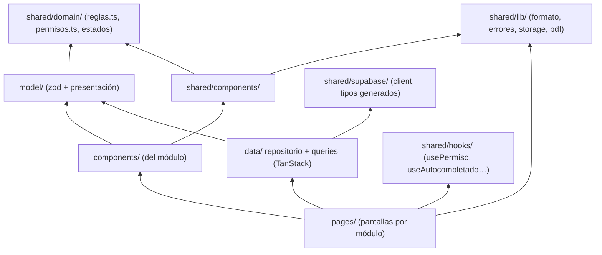
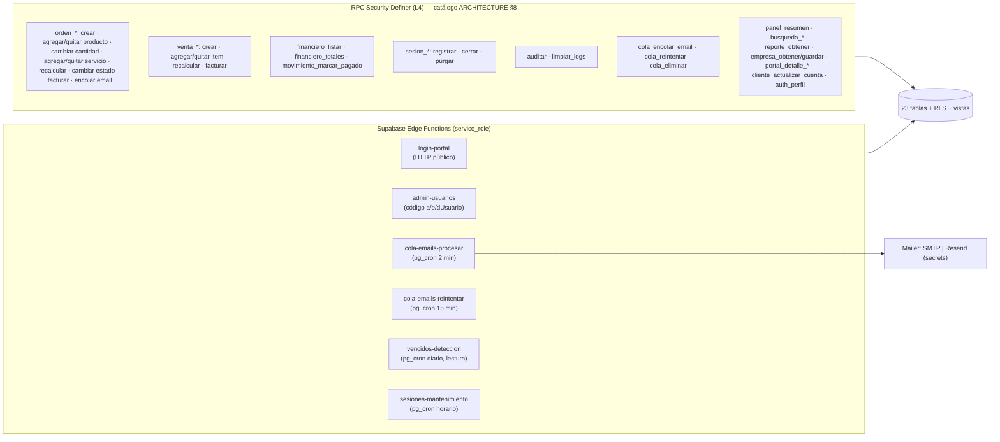

# Diagrama de Componentes — Sistema Taller

| Campo | Valor |
|---|---|
| Proyecto | Sistema Taller (PROJECT-001) |
| Tarea | TASK-0003 — Architecture Design |
| Autor | AG-005 Software Architect |
| Fecha | 2026-11-05 |
| Versión | 1.0 |
| Fuente de verdad | `docs/requirements/SOURCE_PROMPT.md` (SP) |
| Complementa | `ARCHITECTURE.md` (§2, §13/RNF-M-05 y §17 citan este documento) · `ADR.md` (20 decisiones) |

**Convención:** los nombres de módulos, tablas, columnas, estados y códigos de permiso son **literales de SP**, sin renombrar. Diagramas en Mermaid (render offline con cualquier visor estándar).

---

## 1. Objeto

Definir los componentes concretos que implementan la arquitectura de `ARCHITECTURE.md`:

1. Diagrama de componentes del sistema completo (§2).
2. Diagrama de dependencias del frontend por capas (§3).
3. Catálogo de componentes compartidos `shared/` (§4).
4. Componentes backend: Edge Functions, jobs y RPC como unidades de despliegue (§5).
5. **Matriz de permisos** — 14 módulos cubiertos × códigos a/e/d/v/r/c, con el componente que cobra cada código (§6).
6. **Matriz de trazabilidad operativa** — módulo → ruta → componente → tabla → RPC → código de permiso → RF/HU (§7).

La correspondencia carpeta ↔ módulo SP es exacta (ADR-002): 17 carpetas en `src/features/`, ninguna más.

---

## 2. Diagrama de componentes del sistema

```mermaid
graph TD
  subgraph NAVEGADOR["Navegador (SPA React + TypeScript)"]
    direction TB
    subgraph PANEL["Panel administrativo (AdminLayout)"]
      M1["M1 autenticacion-admin<br/>LoginPage"]
      M2["M2 panel-principal<br/>PanelPage"]
      M3["M3 clientes<br/>ClientesPage · ClienteFicha"]
      M4["M4 productos<br/>ProductosPage"]
      M5["M5 servicios<br/>ServiciosPage"]
      M6["M6 ordenes-trabajo<br/>OrdenesPage · OrdenFicha · OrdenImprimir"]
      M7["M7 ventas<br/>VentasPage · VentaFicha · VentaImprimir"]
      M8["M8 garantias<br/>GarantiasPage · GarantiaImprimir"]
      M9["M9 financiero<br/>FinancieroPage · CategoriasTab · CuentasTab"]
      M10["M10 archivos-documentos<br/>DocumentosPage"]
      M11["M11 usuarios<br/>UsuariosPage · UsuarioFicha"]
      M12["M12 permisos<br/>PermisosPage · EditorPermisos"]
      M13["M13 informes-reportes<br/>ReportesPage · VistaPrevioPDF"]
      M14["M14 auditoria<br/>AuditoriaPage"]
      M15["M15 cola-emails<br/>EmailsPage"]
      M17["M17 configuracion-empresa<br/>EmpresaPage"]
    end
    subgraph PORTAL["Portal del cliente (PortalLayout, árbol separado)"]
      M16["M16 portal-cliente<br/>IngresarPage · PortalHome · OrdenDetalle · CompraDetalle · CuentaPage"]
    end
    subgraph APP["app/ + shared/"]
      GUARDS["guards: AdminGuard · PortalGuard · PermisoGuard"]
      PROV["providers: SupabaseClient · AuthContext · QueryClient · Toaster"]
      DATATABLE["shared/components: DataTablePaginado · ModalFormulario · FiltroBar · PermissionGate …"]
      PDF["shared/lib/pdf: motor jsPDF (encabezado empresa · autoTable · pie)"]
      FORMATO["shared/lib: formato dd/mm/aaaa + moneda · errores · storage"]
      REPO["shared/supabase: client.ts (anon) · database.types.ts"]
    end
  end

  subgraph SUPABASE["Supabase (única capa servidor)"]
    AUTH["Auth (identidades admin + portal, <br/>bcrypt, claims rol/usuario_id/cliente_id/permisos)"]
    PG[("PostgreSQL: 23 tablas SP<br/>RLS L3 · RPC L4 · vistas security_invoker · pg_cron")]
    STOR["Storage: anexos-orden · documentos · comprobantes · logos"]
    EF["Edge Functions: login-portal · admin-usuarios · cola-emails-procesar · cola-emails-reintentar · sesiones-mantenimiento"]
  end

  SMTP["Proveedor email (adaptador Mailer: SMTP/Resend, Secrets)"]

  M1 --> GUARDS
  GUARDS --> PROV
  PANEL --> DATATABLE
  M6 --> PDF
  M7 --> PDF
  M8 --> PDF
  M13 --> PDF
  M16 --> PDF
  PANEL --> FORMATO
  PORTAL --> FORMATO
  PANEL --> REPO
  PORTAL --> REPO
  AUTH --> PG
  REPO -->|"tablas + RPC con JWT"| PG
  REPO --> STOR
  EF -->|"service_role"| PG
  EF --> SMTP
  EF --> STOR
  SMTP -.-> M15
```

Los módulos **no se importan entre sí** (ADR-002): toda colaboración pasa por `shared/` o por invalidación de claves de TanStack Query (ADR-010). El portal (M16) es un árbol aparte montado en la misma SPA pero con `PortalGuard` y layout propio (RB-035/C-5).

---

## 3. Dependencias por capas del frontend

Reglas de dependencia (verificables por oxlint y estructura de carpetas):

| # | Regla | Motivo |
|---|---|---|
| D-1 | `features/*` no importa de otro `features/*` | Módulos SP independientes; acoplamiento solo via invalidaciones |
| D-2 | Ningún componente llama `supabase.from/fromRpc` directo | Repositorios = única capa de acceso (ADR-010) |
| D-3 | Ningún módulo renderiza fecha/moneda sin `shared/lib/formato` | RB-007/008, lint `no-restricted-syntax` |
| D-4 | Solo `features/*/model/*.schema.ts` define reglas de campo, derivadas de `shared/domain/reglas.ts` | RNF-S-04 (_coincidencia con CHECK L2_) |
| D-5 | Toda acción oculta en UI usa `<PermissionGate>`/`usePermiso` con el código del vocabulario | RF-009; ocultar no autoriza (validar también L3/L4) |

---

## 4. Componentes compartidos (`src/shared/`)

| Componente | Contrato (resumen) | Módulos que lo usan |
|---|---|---|
| `DataTablePaginado` | columnas declaradas (etiqueta es, alinear, formato), pag server-side (`.range()`), búsqueda servidor, orden, fila→acción | M3…M12, M14, M15 |
| `FiltroBar` | slots: texto, selects, `RangoFechas`, `RangoNumerico`; emite `{filtros, pagina:1}` | M3, M6, M7, M9, M13, M14 |
| `ModalFormulario` | envoltorio shadcn `Dialog` + `Form` RHF+zod, título/botones en español, cierre seguro | todos los CRUD |
| `ConfirmDialog` | confirmación destructive con mensaje español ("Esta acción no se puede deshacer.") | todos los borrados y `limpiar_logs` |
| `Autocomplete` | input con popover + lista obtenida por RPC `busqueda_*` (top 15), retorno selecciona id + snapshot | M6, M7, M9 |
| `CampoMoneda` / `CampoFecha` / `RangoFechas` | input numérico 2 dec. / input fecha (persistido ISO, render dd/mm/aaaa) | M6, M7, M9, M13 |
| `PermissionGate` | `code: CodigoPermiso` ⇒ render children solo si `usePermiso(code)` | todas las acciones del panel |
| `PageHeader` | título + subtítulo + botones de acción (con PermissionGate interno) | todas las páginas |
| `EmptyState` / `ErrorState` | sin datos / error traducido + reintentar | todos los listados |
| `SubirArchivo` | input file + validación tipo/tamaño (20 MB) + thumbnail canvas + upload bucket + firma | M6 (anexos), M9 (comprobantes), M10, M17 (logo) |
| `shared/lib/formato.ts` | `formatoFecha`, `parseFecha`, `formatoMoneda` (default R$, 2 dec.), `redondear2` | transversal |
| `shared/lib/errores.ts` | traduce 23505/23503/42501/P0001→ mensajes en español; canal único toast+inline | transversal |
| `shared/lib/pdf/` | motor ADR-012: `definicion → blob` | M6, M7, M8, M13, M16 |
| `shared/lib/storage.ts` | `subir(bucket, path, file)`, `urlFirmada`, `dataUrlLogo` (caché sesión) | M6, M9, M10, M13, M16, M17 |
| `shared/domain/reglas.ts` | constante única de constantes SP: estados de orden, situaciones, vocabulario de permisos, reglas CHECK documentadas | transversal |
| `shared/hooks/useAuth` | sesión (usuario/perfil/tipo) + `auth_perfil()` + `onAuthStateChange` | M1, M2, guards |
| `shared/hooks/usePaginacion` | estado página/tamaño + sincronizar URL query | listados |

---

## 5. Componentes backend (unidades de despliegue)

| Componente | Disparo | I/O clave | Guardas |
|---|---|---|---|
| `login-portal` | POST público | `{correo, documento}` → tokens + registro `sesiones` | mensaje genérico; auditoría de intentos; ADR-004 |
| `admin-usuarios` | HTTP con JWT admin | identidad `auth.users` + claims de permisos | verifica `a/e/dUsuario` por claim y tabla |
| `cola-emails-procesar` | cron | lote 20 `FOR UPDATE SKIP LOCKED` | RB-015; adaptador Mailer (E-02) |
| `cola-emails-reintentar` | cron | `fallido`(intentos&lt;3)→`pendiente` | RF-073; `intentos` en `encabezados` (ADR-014) |
| `vencidos-deteccion` | cron | detecta vencidos para el panel (sin mutación de negocio) | **solo lectura** (RB-025 en vista) |
| `sesiones-mantenimiento` | cron | `sesion_purgar()` | RF-003/005 |

---

## 6. Matriz de permisos (códigos de actividad × módulos cubiertos)

Vocabulario SP literal: `a`=agregar, `e`=editar, `d`=eliminar, `v`=visualizar, `r`=reporte, `c`=configuración. Se aplican a los **14 módulos cubiertos** de SP M12. `●` = código con efecto en el sistema; `·` = código existe en el editor pero sin acción (SP no le asigna funcionalidad; p.ej. `Respaldo`, RF-060 CA3). El portal (M16) no usa este vocabulario: es un reino de sesión aparte (ADR-004).

| Módulo cubierto (SP M12) | a | e | d | v | r | c | Código de ruta | Componente que aplica el gate |
|---|---|---|---|---|---|---|---|---|
| Cliente (M3) | ● | ● | ● | ● | ● | · | `vCliente`,`aCliente`… | `ClientesPage`, ficha, reporte de clientes (M13) |
| Producto (M4) | ● | ● | ● | ● | ● | · | `vProducto` | `ProductosPage`, alerta stock, reportes |
| Servicio (M5) | ● | ● | ● | ● | ● | · | `vServicio` | `ServiciosPage`, selector de orden |
| Orden (M6) | ● | ● | ● | ● | ● | · | `vOrden` | `OrdenesPage`, ficha, imprimir, facturar, anexos |
| Venta (M7) | ● | ● | ● | ● | ● | · | `vVenta` | `VentasPage`, ficha, imprimir, facturar |
| Garantía (M8) | ● | ● | ● | ● | · | · | `vGarantia` | `GarantiasPage`, selector en orden, imprimir |
| Movimiento (M9) | ● | ● | ● | ● | ● | · | `vMovimiento` | `FinancieroPage`, totales, comprobante |
| Archivo (M10) | ● | ● | ● | ● | · | · | `vArchivo` | `DocumentosPage`, descarga firmada |
| Usuario (M11) | ● | ● | ● | ● | · | · | `vUsuario` | `UsuariosPage` + EF `admin-usuarios` |
| Permiso (M12) | ● | ● | ● | ● | · | · | `vPermiso` | `PermisosPage`, editor, propagación |
| Respaldo | · | · | · | · | · | · | — | **sin pantalla** (SP no define una pantalla de respaldo) |
| Auditoría (M14) | ● | · | ● | ● | · | · | `vAuditoria` | `AuditoriaPage`, `limpiar_logs` (d) |
| Email (M15) | ● | ● | ● | ● | · | · | `vEmail` | `EmailsPage`, reintentar (e), eliminar (d) |
| Empresa (M17) | ● | ● | · | · | · | ● | `cEmpresa` | `EmpresaPage` única (`c` alta inicial, `e` edición) |

Notas:

- `r<Módulo>` no limita el listado: quien puede `v<Módulo>` consulta la tabla; `r` habilita generar el **PDF** del reporte de ese módulo (RF-062…064, gate en `ReportesPage`).
- El panel (M2) y la autenticación (M1) **no** están en el vocabulario de SP, por lo que solo piden sesión admin válida.
- Las RPC de L4 re-verifican el mismo código de su acción (ADR-007): la matriz es también el listado de permisos esperados por `tiene_permiso()` en cada función.

---

## 7. Matriz de trazabilidad operativa

Módulo (SP) → ruta → componentes → tablas → RPC → código de permiso exigido → requisitos/historias. Los nombres de tabla/columnas son literales del SQL de SP; el análogo físico respeta ADR-017.

| M (SP) | Módulo | Ruta(s) | Componentes clave | Tablas | RPC / EF | Código (UI) | RF · HU |
|---|---|---|---|---|---|---|---|
| 1 | Autenticación administrativa | `/login`, `/logout` | `LoginPage`, `AdminGuard`, `useAuth` | usuarios, permisos, sesiones | `auth_perfil`, `sesion_*`; Auth `signInWithPassword` | — | RF-001…006 · HU-001…003 |
| 2 | Panel principal | `/` | `PanelPage` | ordenes_trabajo, productos, ventas, movimientos_financieros, empresa | `panel_resumen` | sesión admin | RF-007…009 · HU-004 |
| 3 | Clientes | `/clientes`, `/clientes/:id` | `ClientesPage`, `ClienteFicha` (+tab equipos), `EquiposTab`, `MarcasInline` | clientes, equipos, marcas, v_cliente_vinculos | CRUD tabla + `busqueda_clientes` | `vCliente` (+a/e/d/r) | RF-010…014 · HU-005…008 |
| 4 | Productos | `/productos`, `/productos/:id` | `ProductosPage` (con `StockAlertaBadge`) | productos, v_stock_alerta | CRUD tabla + `busqueda_productos` | `vProducto` | RF-015…018 · HU-009…011 |
| 5 | Servicios | `/servicios` | `ServiciosPage` (modal) | servicios | CRUD tabla + `busqueda_servicios` | `vServicio` | RF-019 · HU-012 |
| 6 | Órdenes de trabajo | `/ordenes`, `/ordenes/:id`, `/ordenes/:id/imprimir` | `OrdenesPage`, `OrdenFicha` (líneas, equipos, anexos, facturar, enviar), `OrdenImprimir` | ordenes_trabajo, productos_orden, servicios_orden, anexos, equipos_orden, clientes, productos, servicios, garantias, usuarios | `orden_crear`, `orden_agregar/quitar_producto`, `orden_cambiar_cantidad_producto`, `orden_agregar/quitar_servicio`, `orden_cambiar_estado`, `orden_facturar`, `cola_encolar_email`, `busqueda_*` | `vOrden` | RF-020…031 · HU-013…021 |
| 7 | Ventas | `/ventas`, `/ventas/:id`, `/ventas/:id/imprimir` | `VentasPage`, `VentaFicha`, `VentaImprimir` | ventas, items_venta, productos, clientes, usuarios | `venta_crear`, `venta_agregar/quitar_item`, `venta_facturar` | `vVenta` | RF-032…037 · HU-022…024 |
| 8 | Garantías | `/garantias`, `/garantias/:id/imprimir` | `GarantiasPage`, `GarantiaImprimir` | garantias, usuarios | CRUD tabla + `busqueda_garantias` | `vGarantia` | RF-038…040 · HU-025…026 |
| 9 | Financiero | `/financiero`, `/financiero/categorias`, `/financiero/cuentas` | `FinancieroPage` (+`CategoriasTab`, `CuentasTab`), `FiltroPeriodoSituacion` | movimientos_financieros, categorias, cuentas, v_movimientos_situacion | `financiero_listar`, `financiero_totales`, `movimiento_marcar_pagado`, CRUD maestros | `vMovimiento` | RF-041…048 · HU-027…029 |
| 10 | Archivos/Documentos | `/documentos` | `DocumentosPage`, `SubirArchivo` | documentos | CRUD tabla + `storage.urlFirmada` | `vArchivo` | RF-049…053 · HU-030…031 |
| 11 | Usuarios | `/usuarios`, `/usuarios/:id` | `UsuariosPage`, `UsuarioFicha` | usuarios, permisos | EF `admin-usuarios` + CRUD perfil | `vUsuario` | RF-054…058 · HU-032…033 |
| 12 | Permisos | `/permisos`, `/permisos/:id` | `PermisosPage`, `EditorPermisos` (matriz §6) | permisos, usuarios | `permisos_guardar` (propaga claims) | `vPermiso` | RF-059…061 · HU-034…036 |
| 13 | Informes/Reportes | `/reportes`, `/reportes/:familia` | `ReportesPage`, `VistaPrevioPDF` (motor `shared/lib/pdf`) | todas de lectura (por familia) | `reporte_obtener` | `r<Módulo>` + `v<Módulo>` | RF-062…066 · HU-037…039 |
| 14 | Auditoría | `/auditoria` | `AuditoriaPage`, `ConfirmDialog` (limpiar) | logs_auditoria | trigger `tg_auditar`, `auditar`, `limpiar_logs` | `vAuditoria`, `dAuditoria` (limpiar) | RF-067…069 · HU-040…041 |
| 15 | Cola de emails | `/emails` | `EmailsPage` | cola_emails | `cola_encolar_email`, `cola_reintentar`, `cola_eliminar` + EF worker/reintentar | `vEmail` | RF-070…074 · HU-042…043 |
| 16 | Portal del cliente | `/portal`, `/portal/ingresar`, `/portal/ordenes/:id`, `/portal/compras/:id`, `/portal/cuenta`, `/portal/salir` | `IngresarPage`, `PortalHome`, `PortalOrdenDetalle`, `PortalCompraDetalle`, `CuentaPage`, `PortalLayout`, `PortalGuard` | clientes, ordenes_trabajo, ventas, productos_orden, servicios_orden, items_venta, anexos, garantias, empresa | EF `login-portal`, `portal_detalle_orden/venta`, `cliente_actualizar_cuenta` | sesión `rol='cliente'` | RF-075…080 · HU-044…046 |
| 17 | Configuración de empresa | `/empresa` | `EmpresaPage`, `SubirArchivo` (logo) | empresa | `empresa_obtener`, `empresa_guardar`, Storage `logos` | `cEmpresa`, `eEmpresa` | RF-081…082 · HU-047…048 |

Cobertura: **17/17 módulos SP**, 23/23 tablas, 14/14 vocabularios de permisos, RF-001…082 y HU-001…048 completos. La matriz coincide celda a celda con `ARCHITECTURE.md` §17 y con los épicos de `USER_STORIES.md` §2.

---

## 8. Criterios de aceptación de TASK-0003 (parte de este entregable)

- [x] Diagramas de componentes (sistema §2, capas frontend §3, backend §5) en Mermaid.
- [x] Componentes compartidos con contrato verificable (§4).
- [x] Matriz de permisos literal del vocabulario SP, incluido `Respaldo` sin pantalla (§6).
- [x] Matriz de trazabilidad módulo→artefacto→requisito (§7), sin módulos inventados ni renombrados.
- [x] Secciones numeradas para que `ARCHITECTURE.md` (§13/RNF-M-05 y §17) resuelva sus referencias cruzadas (§6 = permisos, §7 = trazabilidad).
