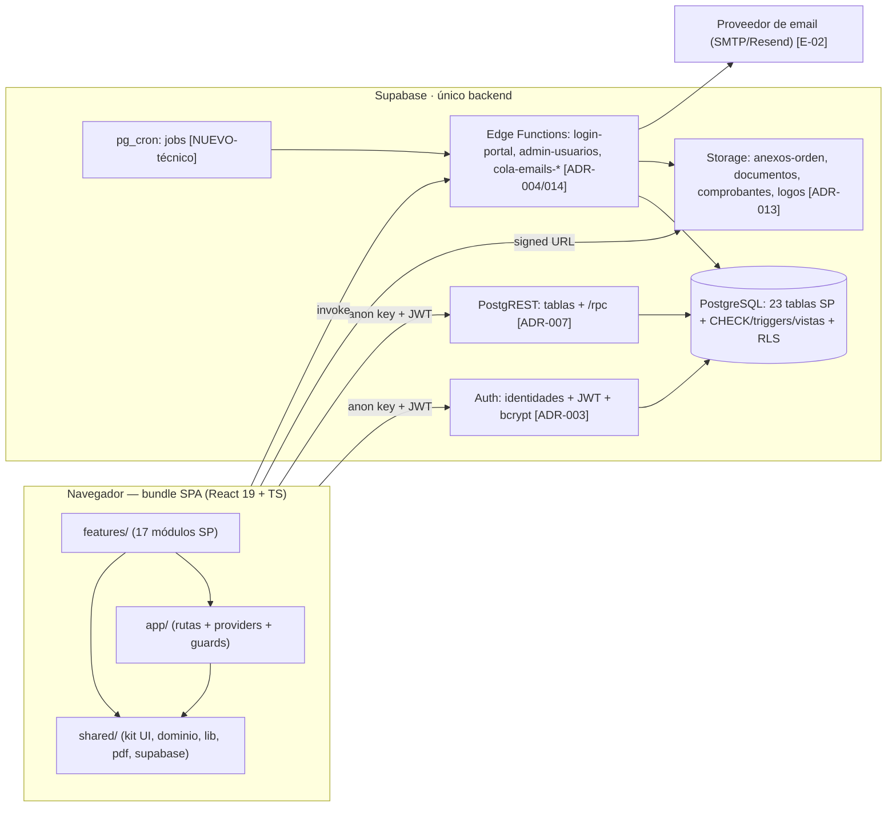
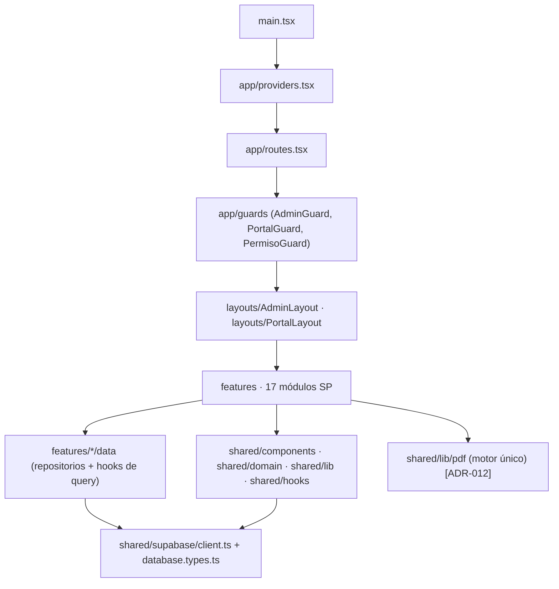
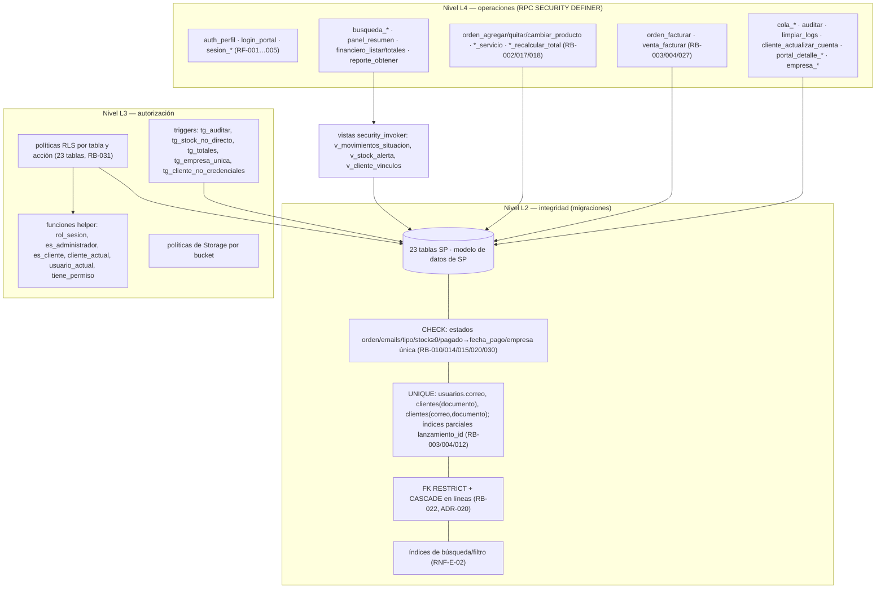
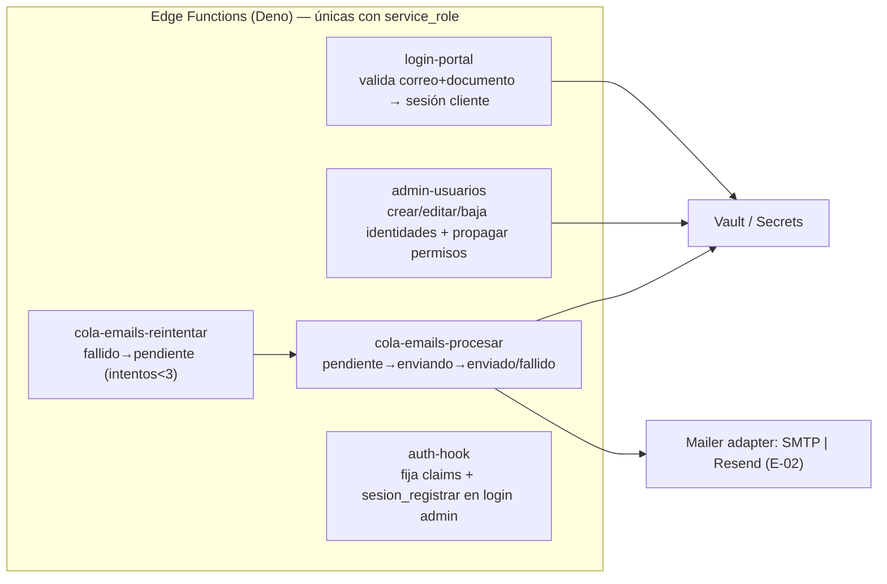
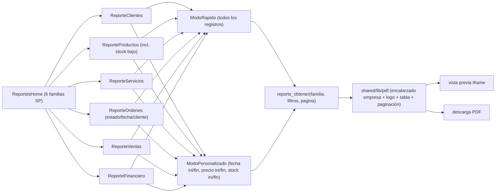
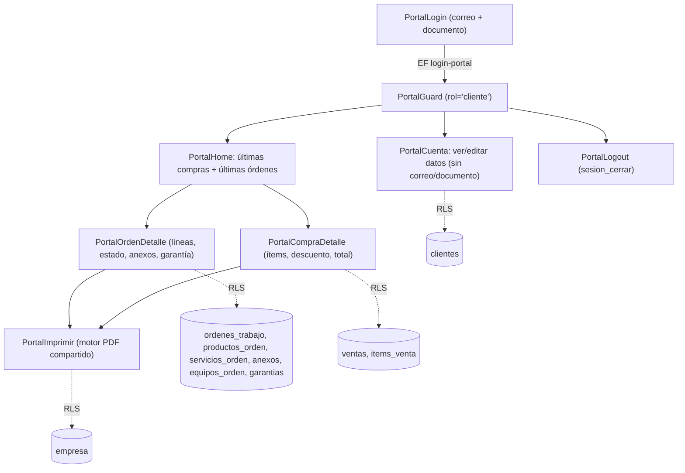
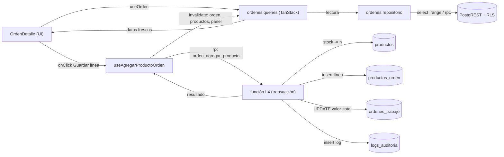

# Diagrama de Componentes — Sistema Taller

| Campo | Valor |
|---|---|
| Proyecto | Sistema Taller (PROJECT-001) |
| Tarea | TASK-0003 — Architecture Design |
| Autor | AG-005 Software Architect |
| Fecha | 2026-11-05 |
| Versión | 1.0 |
| Fuente de verdad | `docs/requirements/SOURCE_PROMPT.md` (SP) |
| Complementa | `ARCHITECTURE.md` (visión y flujos), `ADR.md` (decisiones ADR-001…ADR-020) |
| Cobertura | 17 módulos de SP, 23 tablas de SP, 6 familias de reportes, 2 reinos de sesión |

Este documento descompone el sistema en **componentes implantables**: qué existe, qué depende de qué, qué datos toca y qué requisito satisface. Cada tabla de componentes es la unidad de trabajo para las tareas de implementación y para la matriz de trazabilidad de QA.

**Convenciones de los diagramas.** `»` = flujo de datos en tiempo de ejecución; `-->` = dependencia de compilación/import; los nombres de módulo, tabla y columna son los de SP en español. Etiquetas de estado: `[SP]` obligatorio de SP · `[RF]` requisito funcional · `[NUEVO-técnico]` artefacto de infraestructura sin semántica de negocio nueva.

---

## 1. Vista de conjuntos (contenedores)



**Fronteras y contratos**

| Frontera | Contrato | Quién lo posee | Rompe si… |
|---|---|---|---|
| SPA ↔ PostgREST | tipos generados `database.types.ts` + firma de RPC | esquema (`supabase/migrations`) | se escribe `supabase.from()` fuera de un repositorio |
| SPA ↔ Auth | JWT con `app_metadata.rol/usuario_id/cliente_id/permisos` | EF de login + hook de Auth | el claim de permiso se edita desde el cliente |
| EF ↔ Postgres | `service_role` solo en EF | secretos del proyecto | un secreto aparece en el bundle (RNF-S-07) |
| SPA ↔ Storage | `ruta` autoritativa + URL firmada 60 min | ADR-013 | se confía en `url` persistida para descargar |

---

## 2. Descomposición del frontend y reglas de dependencia



Reglas obligatorias (verificables por lint/`oxlint` `no-restricted-imports`):

| # | Regla | Motivo |
|---|---|---|
| R1 | `features/A` **no** importa de `features/B` (solo de `shared` o del registro de rutas) | aislar los 17 módulos; trazabilidad por módulo |
| R2 | Componentes **no** importan `shared/supabase/client.ts`: solo `features/*/data` | RNF-U-03, ADR-010 (D-06 del prototipo) |
| R3 | Ningún módulo define su propia tabla/paginación: usa `shared/components/DataTablePaginado` | RNF-U-03, ADR-011 |
| R4 | Ninguna fecha/importe se formatea en el JSX: solo `shared/lib/formato.ts` | RB-007/008, RNF-U-05 |
| R5 | El PDF solo se produce vía `shared/lib/pdf` | RNF-P-04 (motor único) |
| R6 | Toda acción de menú/botón sensible pasa por `<PermissionGate>` | RF-006/009, RB-006 |
| R7 | El portal (`features/portal-cliente`) no importa nada del layout administrativo | RB-032, RNF-S-03 |

### 2.1 Plantilla interna de un feature (las 17 carpetas la repiten)

```
features/ordenes-trabajo/
├─ index.ts                     # API pública: rutas, entradas del menú, tipos expuestos
├─ pages/
│  ├─ OrdenesListado.tsx        # tabla paginada + filtros (estado, fecha, cliente)
│  ├─ OrdenDetalle.tsx          # ficha: datos + líneas + anexos + equipos + acciones
│  └─ OrdenImprimir.tsx         # vista/acción de impresión (usa shared/lib/pdf)
├─ components/
│  ├─ OrdenForm.tsx             # RHF + zod
│  ├─ LineasProducto.tsx        # alta/quita líneas → RPC (stock + total)
│  ├─ LineasServicio.tsx
│  ├─ OrdenAnexos.tsx           # upload + miniatura (ADR-013)
│  ├─ OrdenEquipos.tsx          # equipos_orden (RF-031)
│  ├─ OrdenEstados.tsx          # selector de los 6 estados SP (RB-010)
│  ├─ DialogFacturar.tsx        # RF-028
│  └─ DialogEnviarEmail.tsx     # RF-026 → cola_emails
├─ data/
│  ├─ ordenes.repositorio.ts    # select con .range()/filtros + llamadas rpc()
│  └─ ordenes.queries.ts        # useOrdenes, useOrden, useAgregarProductoOrden…
├─ model/
│  ├─ ordenes.schema.ts         # zod (L1) espejo de CHECK (L2) — ADR-019
│  ├─ textos.ts                 # literales en español (RNF-U-01)
│  └─ reglas.ts                 # constantes de negocio del módulo
└─ __tests__/                   # unit + componentes (ADR-018)
```

---

## 3. Componentes compartidos (`shared/`)

| Componente/módulo | Tipo | Responsabilidad | Satisface | Consumido por |
|---|---|---|---|---|
| `supabase/client.ts` | librería | singleton `createClient` con anon key; helper `rpc()` tipado | C-1, RB-036 | repositorios |
| `supabase/database.types.ts` | generado | tipos de las 23 tablas + funciones RPC | RNF-M-01 | repositorios |
| `components/DataTablePaginado` | UI | tabla + cabecera + paginación server-side + estados vacío/carga/error | RNF-U-03, RF-012 | los 17 módulos |
| `components/FiltroBar` | UI | rango de fechas, selects, texto de búsqueda | RF-011, RF-043/044, RF-064 | listados y reportes |
| `components/Autocomplete` | UI | command + debounce sobre RPC `busqueda_*` | RNF-U-04, RF-029 | órdenes, ventas, financiero, usuarios |
| `components/ModalFormulario` | UI | dialog + RHF/zod + botones Guardar/Cancelar | SP diseño, RF-010/015/019 | CRUD |
| `components/ConfirmDialog` | UI | confirmación en español (reemplaza `confirm()`) | RNF-U-01 | bajas |
| `components/CampoMoneda` / `CampoFecha` / `RangoFechas` | UI | entry con máscara/formato | RB-007/008 | formularios |
| `components/PermissionGate` | UI | render condicionado a código | RF-006/009 | menú y acciones |
| `components/SubirArchivo` | UI | selección, validación tipo/tamaño, miniatura canvas | RF-025/048/050 | anexos, documentos, empresa |
| `hooks/useAuth`, `useSesion` | estado | sesión, perfil, tipo de reino | RF-001…006, RF-075 | guards, layout |
| `hooks/usePermiso` | estado | `can('aCliente')` desde claims/tabla | RB-006/029 | gates |
| `hooks/usePaginacion`, `useAutocompletado` | estado | page/pageSize; debounce | RNF-U-03/04 | listados |
| `lib/formato.ts` | dominio | fecha `dd/mm/aaaa`, moneda 2 decimales, redondeo | RB-007/008, RNF-U-05, ADR-016 | todo |
| `lib/permisos.ts` | dominio | matriz 6 actividades × 14 módulos + etiquetas ES | RB-029, RF-060 | módulo Permisos, gates |
| `lib/errores.ts` | dominio | código SQL → mensaje ES (23503/23505/P0001…) | RNF-U-01, RB-022 | repositorios |
| `lib/storage.ts` | infra | subida/bajada, firma de URL, sanitize de nombre | RF-050/052, ADR-013 | anexos, documentos |
| `lib/pdf/` | dominio | motor de documentos (encabezado empresa, tabla, paginación) | RNF-P-04, RB-005, ADR-012 | reportes, orden, venta, garantía, portal |
| `domain/constantes.ts` | dominio | 6 estados de orden, 4 estados de email, situaciones financieras | RB-010/015/026 | validación y UI |

---

## 4. Componentes del lado Supabase

### 4.1 Base de datos (23 tablas SP + artefactos técnicos)



| Objeto | Componentes | Notas |
|---|---|---|
| Tablas `[SP]` | 23: `clientes, productos, servicios, ordenes_trabajo, productos_orden, servicios_orden, ventas, items_venta, garantias, movimientos_financieros, categorias, cuentas, anexos, documentos, marcas, equipos, equipos_orden, usuarios, permisos, empresa, logs_auditoria, cola_emails, sesiones` | 0 añadidas, 0 eliminadas; ajustes de nombre físico en ADR-017 |
| Funciones L4 | catálogo completo en `ARCHITECTURE.md` §8 (≈30 funciones) | punto de entrada único de operaciones compuestas |
| Políticas L3 | 23 tablas × (select/insert/update/delete) + 4 buckets | plantilla en `ARCHITECTURE.md` §9.2 |
| Triggers | auditoría, guardia de stock, recálculo de totales, empresa única, credenciales de portal inmutables | RB-002/009/018/019/030, RF-079 |
| Vistas | situaciones financieras, stock bajo, vínculos de cliente | RB-025/026, RF-016/044/046/013 |
| Jobs (`pg_cron`) | `cola-emails-procesar` (2 min), `cola-emails-reintentar` (15 min), `sesion_purgar` (1 h), `vencidos` (diario) | RNF-A-02, RF-072/073, RF-046 |

### 4.2 Edge Functions



---

## 5. Componentes por módulo (17 módulos SP)

### M1 — Autenticación administrativa (`features/autenticacion-admin`)

| Componente | Tipo | Datos/RPC | Códigos | RF/HU |
|---|---|---|---|---|
| `LoginPage` | página | `signInWithPassword`, auditar | — | RF-001/002, HU-001 |
| `LogoutAction` | componente (topbar) | `signOut()` + `sesion_cerrar()` | — | RF-004, HU-002 |
| `useSesion` | hook | `auth_perfil()` | — | RF-003/006/009 |
| `AdminGuard` / `PortalGuard` / `PermisoGuard` | guards | claims de sesión | `v<Módulo>` | RF-006, RB-035, RNF-S-06 |
| `SesionesListado` (dentro de Usuarios) | tabla | `sesiones` | `vUsuario` | RF-005, HU-003 |

### M2 — Panel principal (`features/panel-principal`)

| Componente | Datos/RPC | Regla | RF/HU |
|---|---|---|---|
| `CardOrdenesAbiertas` | `panel_resumen()` | estados {Abierta, En Proceso, Aguardando Piezas} (+Presupuesto aparte) | RF-007, HU-004 |
| `CardStockBajo` | `v_stock_alerta` | `stock < stock_minimo` | RF-007/016 |
| `CardUltimasVentas` | `panel_resumen()` | últimas 5 por `fecha_venta` | RF-007 |
| `CardMovimientosPendientes` | `v_movimientos_situacion` | `pagado=false` + vencidos (RB-025) | RF-007/046 |
| `AccesosRapidos` | registro de módulos | filtrado por `v<Módulo>` | RF-008/009 |
| `BarraUsuario` | sesión | nombre + cerrar sesión | RF-009 |

### M3 — Clientes (`features/clientes`)

| Componente | Datos/RPC | Códigos | RF/HU |
|---|---|---|---|
| `ClientesListado` | `clientes` + `busqueda_clientes(q)` + `.range()` | `vCliente` | RF-010/011/012, HU-006 |
| `ClienteForm` (modal) | insert/update con `clientes.schema.ts` | `aCliente`/`eCliente` | RF-010 |
| `ClienteEliminar` | delete con manejo `23503` | `dCliente` | RF-010 CA2, RB-022 |
| `ClienteFicha` | `v_cliente_vinculos` + listados filtrados por `cliente_id` | `vCliente` | RF-013, HU-007 |
| `PestanaOrdenes/Ventas/Financiero/Garantias` | rutas filtradas | — | RF-013 |
| `PestanaEquipos` (`EquipoForm`, `MarcaAutocomplete`) | `equipos`, `marcas` (alta en línea) | `eCliente` | RF-014, HU-008, E-04 |

### M4 — Productos (`features/productos`)

| Componente | Datos/RPC | Códigos | RF/HU |
|---|---|---|---|
| `ProductosListado` + `FiltroStockBajo` | `productos`, `v_stock_alerta` | `vProducto` | RF-015/016, HU-009/010 |
| `ProductoForm` | alta/edición (precio_compra/venta, unidad, stock, stock_minimo, salida, entrada) | `aProducto`/`eProducto` | RF-015 |
| `BadgeStockBajo` | derivado | — | RF-016 |
| `AjusteStock` (edición directa autorizada) | `producto_ajustar_stock` + auditoría (GUC permitido) | `eProducto` | RF-015, RB-002 |
| aviso de integridad | invariante probado en `__tests__/propiedades` | — | RF-017/018, HU-011 |

### M5 — Servicios (`features/servicios`)

`ServiciosListado`, `ServicioForm` (nombre, descripción, precio 2 decimales), baja con `RESTRICT` → códigos `vServicio/aServicio/eServicio/dServicio` — RF-019, HU-012.

### M6 — Órdenes de trabajo (`features/ordenes-trabajo`)

| Componente | Datos/RPC | Regla/RF |
|---|---|---|
| `OrdenesListado` | filtros estado/fecha/cliente (`.range()`) | RF-020, RNF-U-03 |
| `OrdenForm` | `orden_crear` / update cabecera | RF-020 |
| `OrdenEstados` | selector cerrado de los 6 estados + `orden_cambiar_estado` | RF-021, RB-010 |
| `Autocompletados` (cliente, producto, servicio, usuario, garantía) | `busqueda_*` (5 conjuntos) | RF-029, RNF-U-04 |
| `LineasProducto` | `orden_agregar_producto` / `orden_quitar_producto` / `orden_cambiar_cantidad_producto` → stock + subtotal + total | RF-022/024/030, RB-002/017/018/021 |
| `LineasServicio` | `orden_agregar_servicio` / `orden_quitar_servicio` | RF-023 |
| `OrdenAnexos` | Storage + `anexos` (anexo, miniatura, url, ruta) | RF-025, ADR-013 |
| `OrdenEquipos` | `equipos_orden` (defecto_declarado/encontrado, solución) | RF-031 |
| `DialogFacturar` | `orden_facturar` (movimiento + `lanzamiento_id` + `facturado`) | RF-028, RB-003/027 |
| `OrdenImprimir` | motor PDF | RF-027, RB-005 |
| `DialogEnviarEmail` | `orden_enviar_email` → `cola_emails` | RF-026, RF-070 |
| aviso de stock | «Stock insuficiente. Disponible: X» | E-01 (ADR-008) |

### M7 — Ventas (`features/ventas`)

`VentasListado`, `VentaForm`, `LineasVenta` (`venta_agregar_item`/`venta_quitar_item` → stock + subtotal), `DescuentoYTotal` (`venta_recalcular_total`, RB-019), `DialogFacturarVenta` (`venta_facturar`, RB-004 + `venta_id`/`lanzamiento_id`), `VentaImprimir` — RF-032…037, HU-022…024.

### M8 — Garantías (`features/garantias`)

`GarantiasListado` (referencia, texto, fecha), `GarantiaForm`, selector en orden (`garantia_id`, autocompletado de términos), `GarantiaImprimir` (motor PDF) — RF-038/039/040, HU-025/026.

### M9 — Financiero (`features/financiero`)

| Componente | Datos/RPC | RF |
|---|---|---|
| `MovimientosListado` | `financiero_listar(periodo, situación, fechas)` paginado | RF-041/043/044 |
| `FiltroPeriodo` (día/semana/mes/año/todos) | parámetro de la RPC | RF-043 |
| `FiltroSituacion` (todos/previsto/atrasado/realizado/pendiente) | `v_movimientos_situacion` (RB-026) | RF-044/046 |
| `TotalesPeriodo` | `financiero_totales` → ingresos, egresos, saldo | RF-045 |
| `MovimientoForm` | CRUD + `movimiento_marcar_pagado` | RF-041, RB-014 |
| `SelectorCategoriaCuenta` | solo activos y `tipo` coincidente | RF-047, RB-016 |
| `AnexoMovimiento` | bucket `comprobantes` | RF-048 |
| `PestanaCategorias` / `PestanaCuentas` | CRUD + `estado` (dentro del módulo, sin módulo nuevo) | RF-047, HU-029, E-04 |

### M10 — Archivos/Documentos (`features/archivos-documentos`)

`DocumentosListado` (filtro/agrupación por `categoria`), `DocumentoForm` + `SubirArchivo` (metadata: documento, descripcion, categoria, tipo, tamaño, fecha_registro), `DescargarDocumento` (URL firmada fresca) — RF-049…053, ADR-013, HU-030/031.

### M11 — Usuarios (`features/usuarios`)

`UsuariosListado`, `UsuarioForm` (nombre, RG, CPF, dirección, correo, teléfono, celular, `estado_usuario`, `fecha_expiracion`, grupo de permisos), `DialogCambiarPassword` (solo EF, sin retorno del hash), `SesionesDelUsuario` (`sesiones`) — RF-054…058, ADR-003, HU-032/033.

### M12 — Permisos (`features/permisos`)

| Componente | Detalle | RF |
|---|---|---|
| `PermisosListado` | grupos con `estado` y `fecha` | RF-059 |
| `EditorCodigos` | matriz generada de `shared/lib/permisos.ts`: 6 actividades × 14 módulos (Cliente, Producto, Servicio, Orden, Venta, Garantía, Movimiento, Archivo, Usuario, Permiso, **Respaldo**, Auditoría, Email, Empresa) con checkboxes; guarda JSONB | RF-060/061, RB-029 |
| `PermisosDeUsuarios` | usuarios afectados por el grupo + propagación de claims | RF-058, RB-023 |
| nota «Respaldo» | códigos reservos sin acción (no se inventa pantalla) | RF-060 CA3, E-08 |

### M13 — Informes/Reportes (`features/informes-reportes`)



Códigos: `rCliente, rProducto, rServicio, rOrden, rVenta, rMovimiento` (+ `c` donde SP lo define) — RF-062…066, HU-037…039.

### M14 — Auditoría (`features/auditoria`)

`AuditoriaListado` (usuario/tarea/fecha, paginado), `LimpiarLogs` (auto-auditoría previa + descarga opcional) — RF-067…069, ADR-015, HU-040/041.

### M15 — Cola de emails (`features/cola-emails`)

`EmailsListado` con filtro por los 4 estados, `EmailForm` (para/cc/cco/mensaje/encabezados), `ProcesarAhora`, `Reintentar` (uno/lote), `Eliminar` — RF-070…074, RB-015, HU-042/043.

### M16 — Portal del cliente (`features/portal-cliente`)



RF-075…080, RB-012/032, ADR-004/E-05, HU-044…046.

### M17 — Configuración de empresa (`features/configuracion-empresa`)

`EmpresaForm` (nombre, CNPJ, IE, dirección, teléfono, correo) en registro único (RB-030), `LogoUploader` (bucket `logos` → `url_logo`), previsualización del encabezado PDF — RF-081/082, ADR-012/013, HU-047/048.

---

## 6. Matriz de permisos → componentes y datos

Módulos cubiertos por SP (RB-029) × códigos de actividad (`a` agregar, `e` editar, `d` eliminar, `v` visualizar, `r` reporte, `c` configuración). La matriz es la fuente del editor del módulo Permisos y de las políticas RLS.

| Módulo SP | Ruta | Tablas | RPC / operaciones | Códigos aplicables |
|---|---|---|---|---|
| Cliente | `/clientes` | `clientes`, `equipos`, `marcas` | CRUD, `busqueda_clientes`, `v_cliente_vinculos` | `aCliente eCliente dCliente vCliente rCliente` |
| Producto | `/productos` | `productos` | CRUD, `busqueda_productos`, `v_stock_alerta` | `aProducto eProducto dProducto vProducto rProducto` |
| Servicio | `/servicios` | `servicios` | CRUD, `busqueda_servicios` | `aServicio eServicio dServicio vServicio rServicio` |
| Orden | `/ordenes` | `ordenes_trabajo`, `productos_orden`, `servicios_orden`, `anexos`, `equipos_orden` | `orden_*`, facturar, enviar email | `aOrden eOrden dOrden vOrden rOrden` |
| Venta | `/ventas` | `ventas`, `items_venta` | `venta_*` | `aVenta eVenta dVenta vVenta rVenta` |
| Garantía | `/garantias` | `garantias` | CRUD, imprimir, `busqueda_garantias` | `aGarantia eGarantia dGarantia vGarantia rGarantia` |
| Movimiento | `/financiero` | `movimientos_financieros`, `categorias`, `cuentas` | `movimiento_*`, `financiero_*` | `aMovimiento eMovimiento dMovimiento vMovimiento rMovimiento` |
| Archivo | `/documentos` | `documentos` (+ bucket) | CRUD, URLs firmadas | `aArchivo eArchivo dArchivo vArchivo rArchivo` |
| Usuario | `/usuarios` | `usuarios`, `sesiones` (+EF) | `admin-usuarios`, `sesion_*` | `aUsuario eUsuario dUsuario vUsuario rUsuario` |
| Permiso | `/permisos` | `permisos` | `permisos_guardar` | `aPermiso ePermiso dPermiso vPermiso rPermiso` |
| Respaldo | — (sin módulo en SP) | — | códigos reservos, **sin acción** | `aRespaldo eRespaldo dRespaldo vRespaldo rRespaldo cRespaldo` |
| Auditoría | `/auditoria` | `logs_auditoria` | `auditar`, `limpiar_logs` | `aAuditoría eAuditoría dAuditoría vAuditoría rAuditoría` |
| Email | `/emails` | `cola_emails` | `cola_*`, EF worker | `aEmail eEmail dEmail vEmail rEmail` |
| Empresa | `/empresa` | `empresa` | `empresa_obtener/guardar` | `cEmpresa eEmpresa vEmpresa aEmpresa dEmpresa rEmpresa` |

Convención SP de capitalizado: `<actividad><Módulo>` con la inicial del módulo en mayúscula (`aCliente`, `eCliente`, `vCliente`, `rCliente`, `aProducto`…). Clave de auditoría y de permisos en español (RNF-U-01) con los **códigos** conservados literalmente como en SP (RB-029).

---

## 7. Trazabilidad operativa por módulo (SP → artefactos)

| M | Módulo (SP) | Feature | Componentes clave | Tablas SP | RPC principales | RF | HU | ADR |
|---|---|---|---|---|---|---|---|---|
| 1 | Autenticación administrativa | `autenticacion-admin` | LoginPage, guards, useSesion | `usuarios`, `permisos`, `sesiones` | `auth_perfil`, `sesion_registrar/cerrar` | RF-001…006 | HU-001…003 | 003, 005, 006 |
| 2 | Panel principal | `panel-principal` | 4 tarjetas + accesos rápidos | `ordenes_trabajo`, `productos`, `ventas`, `movimientos_financieros` | `panel_resumen` | RF-007…009 | HU-004 | 006, 010 |
| 3 | Clientes | `clientes` | listado, ficha, equipos | `clientes`, `equipos`, `marcas` | CRUD, `busqueda_clientes` | RF-010…014 | HU-005…008 | 011, 017, 020 |
| 4 | Productos | `productos` | listado, badge stock, form | `productos` | CRUD, `busqueda_productos` | RF-015…018 | HU-009…011 | 007, 008 |
| 5 | Servicios | `servicios` | listado + modal | `servicios` | CRUD | RF-019 | HU-012 | 019 |
| 6 | Órdenes de trabajo | `ordenes-trabajo` | ficha + líneas + anexos + facturar + imprimir | `ordenes_trabajo`, `productos_orden`, `servicios_orden`, `anexos`, `equipos_orden`, `garantias`, `cola_emails` | `orden_*` | RF-020…031 | HU-013…021 | 007, 008, 009, 012, 013, 014 |
| 7 | Ventas | `ventas` | ficha + ítems + facturar | `ventas`, `items_venta` | `venta_*` | RF-032…037 | HU-022…024 | 007, 009 |
| 8 | Garantías | `garantias` | listado + imprimir | `garantias` | CRUD | RF-038…040 | HU-025/026 | 012 |
| 9 | Financiero | `financiero` | filtros, totales, categorías/cuentas | `movimientos_financieros`, `categorias`, `cuentas` | `movimiento_*`, `financiero_*` | RF-041…048 | HU-027…029 | 010, 016 |
| 10 | Archivos/Documentos | `archivos-documentos` | listado, carga, descarga | `documentos` | CRUD + storage | RF-049…053 | HU-030/031 | 013 |
| 11 | Usuarios | `usuarios` | listado, form, password, sesiones | `usuarios`, `sesiones`, `permisos` | EF `admin-usuarios` | RF-054…058 | HU-032/033 | 003, 005 |
| 12 | Permisos | `permisos` | editor de códigos | `permisos`, `usuarios` | `permisos_guardar` | RF-059…061 | HU-034…036 | 006 |
| 13 | Informes/Reportes | `informes-reportes` | 6 familias, rápido/personalizado, PDF | todas las de lectura | `reporte_obtener` | RF-062…066 | HU-037…039 | 012 |
| 14 | Auditoría | `auditoria` | listado, limpiar | `logs_auditoria` | `auditar`, `limpiar_logs` | RF-067…069 | HU-040/041 | 015 |
| 15 | Cola de emails | `cola-emails` | listado, reintentar, procesar | `cola_emails` | `cola_*` + EF | RF-070…074 | HU-042/043 | 014 |
| 16 | Portal del cliente | `portal-cliente` | login, home, detalle, cuenta, imprimir | `clientes`, `ordenes_trabajo`, `ventas`, `anexos`, `garantias`, `empresa` | `login_portal`, `portal_detalle_*`, `cliente_actualizar_cuenta` | RF-075…080 | HU-044…046 | 004, 012 |
| 17 | Configuración de empresa | `configuracion-empresa` | formulario + logo | `empresa` | `empresa_obtener/guardar` | RF-081/082 | HU-047/048 | 012, 013 |

**Verificación de cobertura:** 17/17 módulos presentes con el nombre de SP · 23/23 tablas referenciadas · RF-001…RF-082 asignados a ≥1 componente · HU-001…HU-048 trazados · RB-001…RB-036 asignados a capa en `ARCHITECTURE.md` §5/§12.

---

## 8. Diagrama de dependencias de datos en tiempo de ejecución (extracto del módulo 6)



---

## 9. Componentes de infraestructura y despliegue

| Componente | Entorno | Configuración | Notas |
|---|---|---|---|
| SPA build (Vite) | local / preview / prod | `VITE_SUPABASE_URL`, `VITE_SUPABASE_ANON_KEY`, `VITE_MONEDA`, `VITE_ZONA` | code-splitting por ruta; presupuesto ≤ 400 KB gzip (RNF-P-03) |
| Hosting estático | preview/prod | CI (GitHub Actions) | Supabase Hosting / Netlify; sin servidor propio (ADR-001) |
| Proyecto Supabase | local (`supabase start`), staging, prod | migrations `0001…0008` + `seed.sql` | `db reset` reproduce esquema + datos de ejemplo (RNF-M-04, RB-001) |
| Edge Functions | mismo proyecto | Secrets/Vault: `SERVICE_ROLE_KEY`, `SMTP_*` | jamás en el bundle (RNF-S-07) |
| pg_cron | mismo proyecto | 4 jobs (§4.1) | idempotentes; sin efectos en negocio |
| Observabilidad | todos | logs de Auth/Postgres/EF, `sentry` opcional `[Recomendada]` | auditoría de negocio vive en `logs_auditoria` (no es log técnico) |

### 9.1 Secuencia de publicación

`migrations (0002→0008)` → `supabase db push` → `deploy EF` → `jobs pg_cron` → `build + deploy SPA` → `smoke E2E` (RB-001: nunca sobre producción destructivo; backups previos según RNF-A-03).

---

## 10. Componentes del prototipo actual y su destino

| Componente existente | Estado | Acción de arquitectura |
|---|---|---|
| `src/lib/supabase.ts` | Reutilizable | envolver en singleton con tipos + `auth_perfil()` |
| `src/contexts/AuthContext.tsx` | Insuficiente | extender a sesión con `rol`, perfil y códigos (ADR-003/006) |
| `src/components/Layout.tsx` | Reutilizable | adaptar a `AdminLayout` con menú filtrado por permisos |
| `src/components/SimpleCrud.tsx` | **Descartar** | reemplazar por `DataTablePaginado` + `ModalFormulario` + repositorios (D-06) |
| `src/components/ui/*` (9 componentes) | Reutilizable | añadir `pagination, tabs, command, popover, dropdown-menu, sonner, checkbox, sheet, tooltip, skeleton` |
| `src/pages/*.tsx` (17 pantallas) | Semilla | migrar a `src/features/<módulo>/pages/` con datos tipados |
| `src/App.tsx` | Reutilizable | mover a `src/app/routes.tsx` + guards (D-08) |
| `supabase/migrations/0001_init.sql` | **Defectuoso** | corregir en `0002_schema_fixes.sql` (D-01); eliminar RLS permissiva y la política `anon read clientes` (D-02/D-03, E-09) |
| `supabase/seed.sql` | Reutilizable | completar con datos de ejemplo mínimos de SP §ENTREGABLE (RNF-M-04) |

---

## 11. Pendientes de diseño que este documento deja visibles

1. **E-01 (stock)**: si AG-001 elige "advertir y permitir", cambian `LineasProducto`, la RPC `stock_puede_descontarse`, el `CHECK` y la prueba de propiedad.
2. **E-02 (proveedor de email)**: define solo la implementación del adaptador `Mailer` en la EF `cola-emails-procesar`.
3. **E-04**: confirmación de que Equipos/Marcas viven como pestañas de Clientes y Órdenes (sin módulo nuevo).
4. **E-06**: símbolo de moneda y zona horaria por defecto (afecta únicamente a `shared/lib/formato.ts` y a `ALTER DATABASE … SET timezone`).
5. **E-09 / D-01…D-03**: corrección previa de la migración y de las políticas RLS antes de programar módulos (crítico de seguridad).
6. Diseño visual de los 6 reportes (ancho de columnas y totales) — se resuelve con el `DocumentoDef` del motor PDF, sin impacto estructural.
