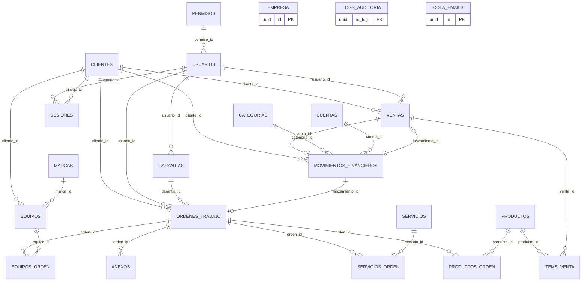

# Modelo de Datos — Sistema Taller

| Campo | Valor |
|---|---|
| Proyecto | Sistema Taller (PROJECT-001) |
| Tarea | TASK-0005 — Database Design |
| Autor | AG-007 Database Architect |
| Fecha | 2026-11-05 |
| Versión | 1.0 |
| Fuente de verdad | `docs/requirements/SOURCE_PROMPT.md` (SP), sección «MODELO DE DATOS (PostgreSQL, nombres en español)» |
| Insumos | `BUSINESS_RULES.md` v2.0 (RB-001…RB-036), `FUNCTIONAL_REQUIREMENTS.md` v2.0 (RF-001…RF-082), `NON_FUNCTIONAL_REQUIREMENTS.md` (RNF-*), `ARCHITECTURE.md` v1.0 de TASK-0003 (§7 arquitectura de datos, §9 seguridad, §15 estado del repo) |
| Archivos hermanos | `schema.sql` (DDL canónico ejecutable) · `RLS_POLICIES.md` (diseño de políticas y matriz de permisos) |
| Estado | Propuesto — listo para revisión de AG-004/AG-005. **No se ejecuta ninguna migración en F2** ( instruccion de tarea); `schema.sql` es el artefacto de diseño que la tarea de implementación (TASK-0004) materializará como `0002…0008` de `ARCHITECTURE.md` §15. |
| Stack obligatorio | React + TypeScript + Tailwind CSS + shadcn/ui + Supabase (PostgreSQL, Auth, Storage, RLS) |

---

## 1. Objeto y alcance

Este documento define el modelo físico de datos de "Sistema Taller": las **23 tablas** exigidas
por SP (22 de negocio + `sesiones`), sus columnas, tipos, relaciones, restricciones
(CHECK/UNIQUE/FK), índices, vistas, triggers a nivel de modelo y la estrategia de seguridad
(descrita en detalle en `RLS_POLICIES.md`).

**Límites (no negociables, SP §MODELO DE DATOS):**

- Los **nombres de tablas y columnas son los de SP**, en español, sin renombres de negocio.
- **No se agregan, eliminan ni renombran** entidades del modelo SP.
- Las reglas de SP §REGLAS DE NEGOCIO (stock, facturación única, empresa, formatos, auditoría)
  están materializadas en el esquema (L2) y referidas a `BUSINESS_RULES.md` RB-001…RB-036.

Los tres únicos ajustes técnicos (sin cambio semántico) están justificados por la colisión o
encoding real detectado en TASK-0003 (§15, hallazgo D-01, ADR-017) y se listan en §2.

---

## 2. Convenciones físicas `[Heredadas — ADR-017]`

1. **PK**: `id_<entidad>` con el nombre exacto de SP (`id_cliente`, `id_orden`, `id_producto`,
   `id_movimiento`, …), tipo **`uuid`** con `default gen_random_uuid()`.
   Excepción literal de SP: la PK de `empresa` y de `cola_emails` es `id`.
2. **FK**: `ON DELETE RESTRICT` por defecto (RB-022: «No se elimina un registro referenciado por
   FK»). `ON DELETE CASCADE` solo en las tablas línea que no tienen identidad propia fuera de su
   documento padre (SP las modela como hijos directos): `productos_orden`, `servicios_orden`,
   `items_venta`, `anexos`, `equipos_orden` `[Inferida]`. Matriz completa en §5.
3. **Dinero y cantidades**: `numeric(12,2)` (RB-008: 2 decimales). Nunca `float`/`real`.
4. **Fechas**: `date` para fechas de negocio (`fecha_inicial`, `fecha_final`, `fecha_venta`,
   `fecha_vencimiento`, `fecha_garantia`, `fecha_expiracion`, `fecha_fabricacion`);
   `timestamptz` para `fecha_registro`, `sesiones.*`, `cola_emails.fecha`.
   `logs_auditoria` mantiene `fecha date` + `hora time`, literal de SP (RB-028).
   Zona horaria de la base: `America/Sao_Paulo` (E-06); formato visible `dd/mm/aaaa` solo en la UI.
5. **Enums como `text` + `CHECK`** (no `CREATE TYPE`, para no bloquear futuros ajustes):
   - `ordenes_trabajo.estado ∈ ('Presupuesto','Abierta','En Proceso','Finalizado','Cancelado','Aguardando Piezas')` — RB-010, SP literal.
   - `movimientos_financieros.tipo`, `categorias.tipo`, `cuentas.tipo ∈ ('ingreso','egreso')`.
   - `cola_emails.estado ∈ ('pendiente','enviando','enviado','fallido')` — SP literal.
   - `sesiones.tipo ∈ ('administrador','cliente')` — RB-032.
6. **Ajustes técnicos obligados** (los únicos desvío del texto literal de SP):
   | SP literal | Columna física | Motivo |
   |---|---|---|
   | `usuarios: estado (dirección) + estado (booleano)` | `estado text` (región) + **`estado_usuario boolean`** | Postgres no admite dos columnas con el mismo nombre; defecto bloqueante D-01 de `0001_init.sql` |
   | `documentos.tamaño` | **`tamanio`** | Postgres, sin `ñ` (evita quoting/encoding); etiqueta UI «Tamaño» |
   | `usuarios.contraseña` | **no existe en `public.usuarios`**; el hash lo custodia `auth.users.encrypted_password` (bcrypt) vía Supabase Auth | RF-002/RNF-S-01: ningún hash viaja por `public`; SP pide «hash seguro (bcrypt/argon2)» |
7. **`permisos.permisos`**: `jsonb` con array de códigos (`["aCliente","vOrden"]`). SP admite
   «texto separado por coma o JSON»; JSONB permite `?` en las políticas RLS sin `LIKE` (RF-061).
8. **`cola_emails.encabezados`**: `text` (SP) con contenido JSON serializado
   (`asunto`, `intentos`, `ultimo_error`), sin columnas nuevas fuera del modelo.
9. Tablas/vistas: `if not exists` en DDL; todas con RLS activado (RB-031, detalle §9).

---

## 3. Diagrama entidad-relación (23 tablas)

Igual al ERD aprobado en `ARCHITECTURE.md` §7.2 (fuente TASK-0003). Ninguna tabla añadida ni eliminada.

**Relación que no es FK** (decidida en TASK-0003 §7.2, RF-013): `clientes → garantias` se recorre
vía `ordenes_trabajo.garantia_id` — la ficha de cliente calcula sus garantías a través de sus
órdenes, sin añadir columna fuera del modelo SP.

---

## 4. Catálogo de tablas

Formato: Columna | Tipo | Nulo | Defecto | Notas. Las FK se detallan en §5.
`R` = restricciones; cada tabla lista `CHECK`/`UNIQUE`/índice parcial y su RB/RF.

### 4.1 `empresa` — Configuración de empresa (SP entidad + módulo 17)

| Columna | Tipo | Nulo | Defecto | Notas |
|---|---|---|---|---|
| id | uuid | no | `gen_random_uuid()` | PK (SP: `id`) |
| nombre | text | no | — | Nombre comercial; encabezado de PDFs (RB-005) |
| cnpj | text | sí | — | |
| ie | text | sí | — | |
| calle, numero, barrio, ciudad, provincia | text | sí | — | Dirección fiscal |
| telefono, correo | text | sí | — | |
| url_logo | text | sí | — | Ruta Storage (`logos/…`); se usa en encabezado de reportes |

R: **registro único** (RB-030, RF-081) — trigger `tg_empresa_unica` (§7.1) rechaza una 2ª fila.
La UI solo «crea» la primera vez y luego edita.

### 4.2 `permisos` — Permisos (módulo 12)

| Columna | Tipo | Nulo | Defecto | Notas |
|---|---|---|---|---|
| id_permiso | uuid | no | gen | PK |
| nombre | text | no | — | p. ej. «Administrador» |
| permisos | jsonb | no | `'[]'::jsonb` | Array de códigos: a/e/d/v/r/c + módulo (SP §11, RB-029) |
| estado | boolean | no | `true` | RB-023: grupo inactivo no otorga acceso |
| fecha | date | no | `current_date` | SP |

R: `UNIQUE (nombre)`. Vocabulario cerrado: 14 módulos × 6 actividades → códigos
`aCliente, eCliente, dCliente, vCliente, rCliente … aEmpresa …(`ver matriz en RLS_POLICIES.md §2`).

### 4.3 `usuarios` — Usuarios (módulo 11, perfil; identidad en `auth.users`)

| Columna | Tipo | Nulo | Defecto | Notas |
|---|---|---|---|---|
| id_usuario | uuid | no | gen | PK = `auth.users.id` (identity administrativa, FK lógica por correo) |
| nombre | text | no | — | |
| rg, cpf | text | sí | — | |
| calle, numero, barrio, ciudad | text | sí | — | |
| estado | text | sí | — | **Región/provincia** (dirección) — ADR-017 |
| correo | text | no | — | `UNIQUE`; calza con `auth.users.email` |
| telefono, celular | text | sí | — | |
| estado_usuario | boolean | no | `true` | **activo/inactivo** — ADR-017 (RB-023) |
| fecha_registro | timestamptz | no | `now()` | SP |
| permiso_id | uuid | sí | — | FK permisos (RB-023) |
| fecha_expiracion | date | sí | — | RB-024: vence el login (no la sesión ya iniciada) |

R: `UNIQUE (correo)`; `UNIQUE (cpf)` parcial `WHERE cpf IS NOT NULL` `[Inferida]`.
`contrasena` NO existe aquí (§2.6): alta/cambio de contraseña solo por Edge Function `admin-usuarios`.
RLS: solo administradores con `v/a/e/dUsuario`. El propio perfil se expone por RPC `auth_perfil()`.

### 4.4 `clientes` — Clientes (módulo 3 y sujeto del portal 16)

| Columna | Tipo | Nulo | Defecto | Notas |
|---|---|---|---|---|
| id_cliente | uuid | no | gen | PK |
| nombre_cliente | text | no | — | Búsqueda (RF-011) |
| sexo | text | sí | — | |
| persona_fisica | boolean | no | `true` | `false` ⇒ empresa (documento = CNPJ) |
| documento | text | sí | — | Credencial del portal junto con `correo` (RB-012, RF-075) |
| telefono, celular | text | sí | — | |
| correo | text | sí | — | |
| fecha_registro | timestamptz | no | `now()` | |
| calle, numero, barrio, ciudad, estado, codigo_postal | text | sí | — | `estado` = región (no hay colisión aquí) |

R:
- `UNIQUE (documento) WHERE documento IS NOT NULL` (RF-054 deduplicación) `[Heredada TASK-0003 §7.3]`.
- `UNIQUE (lower(correo), documento) WHERE correo IS NOT NULL AND documento IS NOT NULL` —
  par de acceso al portal sin duplicados (RB-012) `[Inferida]`.
- Índices trigram/btree `lower(nombre_cliente)`, `lower(correo)` (RF-011, RNF-U-04).
- Trigger `tg_cliente_no_credenciales` (§7.2): una sesión `cliente` no puede cambiar
  `correo`/`documento` (E-05, RF-079, oQ-05).

### 4.5 `productos` — Productos (módulo 4)

| Columna | Tipo | Nulo | Defecto | Notas |
|---|---|---|---|---|
| id_producto | uuid | no | gen | PK |
| descripcion | text | no | — | |
| unidad | text | sí | — | `un`, `kg`, `h`, … |
| precio_compra | numeric(12,2) | no | 0 | ≥ 0 |
| precio_venta | numeric(12,2) | no | 0 | ≥ 0 |
| stock | numeric(12,2) | no | 0 | ≥ 0 (RB-020); updates directos bloqueados (§7.3) |
| stock_minimo | numeric(12,2) | no | 0 | ≥ 0; alerta vista `v_stock_alerta` (RF-016) |
| salida | boolean | no | `false` | Semántica E-07: habilita como línea de orden/venta |
| entrada | boolean | no | `false` | E-07: habilita como insumo recibible (informativo) |

R: `CHECK (stock >= 0 AND stock_minimo >= 0 AND precio_compra >= 0 AND precio_venta >= 0)` (RB-008/020).

### 4.6 `servicios` — Servicios (módulo 5)

| Columna | Tipo | Nulo | Defecto | Notas |
|---|---|---|---|---|
| id_servicio | uuid | no | gen | PK |
| nombre | text | no | — | |
| descripcion | text | sí | — | |
| precio | numeric(12,2) | no | 0 | ≥ 0 |

### 4.7 `garantias` — Garantías (módulo 8; términos)

| Columna | Tipo | Nulo | Defecto | Notas |
|---|---|---|---|---|
| id_garantia | uuid | no | gen | PK |
| fecha_garantia | date | no | `current_date` | |
| referencia | text | sí | — | |
| texto_garantia | text | sí | — | Términos imprimibles (RF-039/RF-040) |
| usuario_id | uuid | sí | — | FK usuarios |

### 4.8 `categorias` — Categorías financieras (módulo 9)

| Columna | Tipo | Nulo | Defecto | Notas |
|---|---|---|---|---|
| id_categoria | uuid | no | gen | PK |
| categoria | text | no | — | |
| fecha_registro | timestamptz | no | `now()` | |
| estado | boolean | no | `true` | |
| tipo | text | no | — | CHECK `('ingreso','egreso')` |

### 4.9 `cuentas` — Cuentas (módulo 9)

| Columna | Tipo | Nulo | Defecto | Notas |
|---|---|---|---|---|
| id_cuenta | uuid | no | gen | PK |
| cuenta | text | no | — | |
| banco | text | sí | — | |
| numero | text | sí | — | |
| saldo | numeric(12,2) | no | 0 | Informativo (SP); no se recalcula automáticamente `[Inferida]` |
| fecha_registro | timestamptz | no | `now()` | |
| estado | boolean | no | `true` | |
| tipo | text | no | — | CHECK `('ingreso','egreso')` — `ídem` según TASK-0003 §7.1.6 |

### 4.10 `ordenes_trabajo` — Órdenes de trabajo (módulo 6)

| Columna | Tipo | Nulo | Defecto | Notas |
|---|---|---|---|---|
| id_orden | uuid | no | gen | PK |
| fecha_inicial | date | no | `current_date` | |
| fecha_final | date | sí | — | >= `fecha_inicial`; se fija al pasar a `Finalizado` (RF-021) `[Inferida]` |
| garantia | text | sí | — | Condición declarada al recibir (E-07); distinto de `garantia_id` |
| descripcion_producto | text | sí | — | |
| defecto | text | sí | — | |
| estado | text | no | 'Presupuesto' | CHECK: 6 estados SP literales (RB-010) |
| observaciones | text | sí | — | |
| laudo_tecnico | text | sí | — | |
| valor_total | numeric(12,2) | no | 0 | = Σ productos_orden + Σ servicios_orden (RB-018); no editable directo |
| cliente_id | uuid | sí | — | FK clientes |
| usuario_id | uuid | sí | — | FK usuarios (técnico responsable) |
| lanzamiento_id | uuid | sí | — | FK movimientos_financieros (RB-027); índice parcial único |
| facturado | boolean | no | `false` | RB-003: una sola facturación |
| garantia_id | uuid | sí | — | FK garantias (término del catálogo) |

R:
- `CHECK (estado IN ('Presupuesto','Abierta','En Proceso','Finalizado','Cancelado','Aguardando Piezas'))`
- `CHECK (valor_total >= 0 AND fecha_final IS NULL OR fecha_final >= fecha_inicial)` *
- `CHECK (lanzamiento_id IS NULL OR facturado)` — coherencia RB-003/RB-027.
- `CREATE UNIQUE INDEX … ON ordenes_trabajo (lanzamiento_id) WHERE lanzamiento_id IS NOT NULL`
  (un solo vínculo de facturación por orden).
- Índices: `(estado)`, `(fecha_inicial)`, `(cliente_id)`, `(usuario_id)`, `(facturado)`.

\* Precedencia corregida en `schema.sql`: `CHECK ((fecha_final IS NULL) OR (fecha_final >= fecha_inicial))`.

### 4.11 `productos_orden` — líneas de producto (hijo de orden)

| Columna | Tipo | Nulo | Defecto | Notas |
|---|---|---|---|---|
| id_producto_orden | uuid | no | gen | PK |
| cantidad | numeric(12,2) | no | 1 | > 0 |
| descripcion | text | sí | — | **Snapshot** del producto al agregar (RB-021) |
| precio | numeric(12,2) | no | 0 | Snapshot; ≥ 0 |
| orden_id | uuid | no | — | FK ordenes_trabajo **CASCADE** |
| producto_id | uuid | sí | — | FK productos |
| subtotal | numeric(12,2) | no | 0 | `round(cantidad*precio, 2)`; recalcula `valor_total` (trigger §7.4) |

R: `CHECK (cantidad > 0 AND precio >= 0 AND subtotal >= 0)` (RB-019). El descuento de stock y el
recálculo ocurren en `orden_agregar_producto`/`orden_cambiar_cantidad_producto` (RPC, TASK-0004).

### 4.12 `servicios_orden` — líneas de servicio (hijo de orden)

Same shape: `id_servicio_orden`, `servicio text` (snapshot), `cantidad`, `precio`, `orden_id CASCADE`,
`servicio_id`, `subtotal`. Sin stock (RB-002 solo aplica a productos).

### 4.13 `ventas` — Ventas (módulo 7)

| Columna | Tipo | Nulo | Defecto | Notas |
|---|---|---|---|---|
| id_venta | uuid | no | gen | PK |
| fecha_venta | date | no | `current_date` | |
| valor_total | numeric(12,2) | no | 0 | = Σ items_venta − descuento (RB-019) `[Inferida]` |
| descuento | numeric(12,2) | no | 0 | ≥ 0 |
| facturado | boolean | no | `false` | RB-004: una sola facturación |
| cliente_id, usuario_id | uuid | sí | — | FK clientes, usuarios |
| lanzamiento_id | uuid | sí | — | FK movimientos_financieros (RB-027; coexiste con `venta_id`) |

R: `CHECK (descuento >= 0 AND valor_total >= 0)`; `CHECK (lanzamiento_id IS NULL OR facturado)`;
índice parcial único en `lanzamiento_id`; índices `(fecha_venta)`, `(cliente_id)`, `(facturado)`.

### 4.14 `items_venta` — líneas de venta (hijo de venta)

`id_item_venta`, `cantidad > 0`, `descripcion` (snapshot RB-021), `precio ≥ 0`,
`venta_id` FK **CASCADE**, `producto_id`, `subtotal`. El descuento de stock sigue la misma mecánica que `productos_orden`.

### 4.15 `movimientos_financieros` — Financiero (módulo 9)

| Columna | Tipo | Nulo | Defecto | Notas |
|---|---|---|---|---|
| id_movimiento | uuid | no | gen | PK |
| descripcion | text | no | — | |
| valor | numeric(12,2) | no | 0 | > 0 |
| fecha_vencimiento | date | sí | — | Base de "atrasado" (RB-025) |
| fecha_pago | date | sí | — | Requerida si `pagado` (RB-014) |
| pagado | boolean | no | `false` | |
| cliente_proveedor | text | sí | — | SP: texto libre; coexiste con `cliente_id` (RF-042) |
| forma_pago | text | sí | — | |
| tipo | text | no | — | CHECK `('ingreso','egreso')` |
| anexo | text | sí | — | Ruta Storage `comprobantes/…` |
| cliente_id | uuid | sí | — | FK clientes |
| categoria_id | uuid | sí | — | FK categorias |
| cuenta_id | uuid | sí | — | FK cuentas |
| venta_id | uuid | sí | — | FK ventas; índice parcial único (un movimiento por venta) |

R: `CHECK (valor > 0)`; `CHECK (pagado = false OR fecha_pago IS NOT NULL)`.
Filtros RF-043/044/046 y situación RB-026 se resuelven en la vista `v_movimientos_situacion` (§6).

### 4.16 `anexos` — adjuntos de orden (módulo 6)

`id_anexo` PK; `anexo` (nombre), `miniatura` (ruta `.thumb.webp`), `url` (firma temporal, nunca
autoritativa), `ruta` (bucket/ruta, **fuente de verdad**), `orden_id` FK **CASCADE**. (ADR-013).

### 4.17 `documentos` — Archivos/Documentos (módulo 10)

| Columna | Tipo | Nulo | Defecto | Notas |
|---|---|---|---|---|
| id_documento | uuid | no | gen | PK |
| documento | text | no | — | Nombre para mostrar |
| descripcion | text | sí | — | |
| archivo | text | sí | — | Nombre original del archivo |
| ruta | text | sí | — | Ruta Storage `documentos/…` |
| url | text | sí | — | URL firmada (regenerada al listar) |
| fecha_registro | timestamptz | no | `now()` | |
| categoria | text | sí | — | Texto con sugerencias `DISTINCT` (E-04) — **no** FK a categorias |
| tipo | text | sí | — | MIME o categoría propia; ídem |
| tamanio | bigint | sí | — | **`tamanio`** (sin ñ) — §2.6 |

### 4.18 `marcas` — marcas de equipos (sub-recurso de Clientes/Órdenes, E-04)

`id_marca` PK, `marca`, `fecha_registro timestamptz`, `estado boolean` (alta en línea al crear un
equipo). Sin módulo propio: se administra por códigos `…Cliente`/`…Orden` según pantalla `[Inferida E-04]`.

### 4.19 `equipos` — equipos del cliente (sub-recurso de Clientes/Órdenes, E-04)

| Columna | Tipo | Nulo | Defecto | Notas |
|---|---|---|---|---|
| id_equipo | uuid | no | gen | PK |
| equipo | text | no | — | |
| numero_serie | text | sí | — | |
| modelo, color, descripcion | text | sí | — | |
| tension, potencia, voltaje | text | sí | — | SP los trae como campos libres |
| fecha_fabricacion | date | sí | — | |
| marca_id, cliente_id | uuid | sí | — | FK marcas, clientes |

### 4.20 `equipos_orden` — equipo(s) intervenido(s) por orden (hijo)

`id_equipo_orden` PK; `defecto_declarado`, `defecto_encontrado`, `solucion` text;
`equipo_id`, `orden_id` FK **CASCADE** (RF-031).

### 4.21 `logs_auditoria` — Auditoría (módulo 14)

| Columna | Tipo | Nulo | Defecto | Notas |
|---|---|---|---|---|
| id_log | uuid | no | gen | PK |
| usuario | text | sí | — | Nombre/alias del usuario; sistema → `system` |
| tarea | text | sí | — | Acción descriada (lista cerrada, TASK-0003 §9.3) |
| fecha | date | no | `current_date` | SP literal |
| hora | time | no | `current_time` | SP literal |
| ip | text | sí | — | `request.jwt.headers` → `x-forwarded-for` |

R: índice `(fecha DESC, hora DESC)` y `(usuario)` (RF-068). **No hay FK** (independencia de la
historial ante bajas). Escritura solo por RPC/trigger `definer`; lectura `vAuditoria`;
borrado `dAuditoria` con auto-log previo (RF-069, `limpiar_logs`).

### 4.22 `cola_emails` — Cola de emails (módulo 15)

| Columna | Tipo | Nulo | Defecto | Notas |
|---|---|---|---|---|
| id | uuid | no | gen | PK (SP: `id`) |
| para | text | no | — | |
| cc, cco | text | sí | — | |
| mensaje | text | sí | — | |
| estado | text | no | 'pendiente' | CHECK 4 estados SP literales (RB-015) |
| fecha | timestamptz | no | `now()` | |
| encabezados | text | sí | — | JSON serializado: `asunto`, `intentos`, `ultimo_error` |

Transiciones válidas (RB-015): `pendiente → enviando → enviado | fallido`;
`fallido → pendiente` (reintento, RF-073) — validadas por la Edge Function worker (TASK-0003 §11);
la tabla no publica INSERT/UPDATE directos (solo servicio `service_role`).

### 4.23 `sesiones` — tabla de sesiones de base de datos (SP: "sesiones")

| Columna | Tipo | Nulo | Defecto | Notas |
|---|---|---|---|---|
| id_sesion | uuid | no | gen | PK (id de sesión de Auth) |
| usuario_id | uuid | sí | — | FK usuarios `ON DELETE CASCADE`; exclusivo mutuo con `cliente_id` |
| cliente_id | uuid | sí | — | FK clientes `ON DELETE CASCADE` |
| tipo | text | no | — | CHECK `('administrador','cliente')` (RB-032) |
| inicio_sesion | timestamptz | no | `now()` | |
| expiracion | timestamptz | no | — | Vigencia RF-005 `[Inferida RNF-S-08]`: 12 h admin / 24 h cliente |
| ip | text | sí | — | |
| activa | boolean | no | `true` | |

R: `CHECK (num_nonnulls(usuario_id, cliente_id) = 1)`.
Escritura solo por RPC/EF (`sesion_registrar`, `sesion_cerrar`, `sesion_purgar` — TASK-0003 §8);
no duplica tokens; es la "tabla de sesiones de base de datos" exigida por SP.

---

## 5. Relaciones y política de borrado

| FK | Desde → Hacia | ON DELETE | Justificación |
|---|---|---|---|
| permisos → usuarios | usuarios.permiso_id | RESTRICT | RB-022: grupo referenciado no se elimina (se desactiva) |
| usuarios → ordenes_trabajo.usuario_id | RESTRICT | | integridad de responsable |
| usuarios → ventas.usuario_id | RESTRICT | | ídem |
| usuarios → garantias.usuario_id | RESTRICT | | ídem |
| clientes → ordenes_trabajo.cliente_id | RESTRICT | | RF-013: bloqueo por vínculos |
| clientes → ventas.cliente_id | RESTRICT | | |
| clientes → movimientos_financieros.cliente_id | RESTRICT | | |
| clientes → equipos.cliente_id | RESTRICT | | |
| marcas → equipos.marca_id | RESTRICT | | |
| equipos → equipos_orden.equipo_id | RESTRICT | equipo tiene vida propia |
| garantias → ordenes_trabajo.garantia_id | RESTRICT | término en uso |
| categorias → movimientos_financieros.categoria_id | RESTRICT | |
| cuentas → movimientos_financieros.cuenta_id | RESTRICT | |
| **ordenes_trabajo → productos_orden.orden_id** | **CASCADE** | hijo sin vida propia (§2.2) |
| **ordenes_trabajo → servicios_orden.orden_id** | **CASCADE** | |
| **ordenes_trabajo → anexos.orden_id** | **CASCADE** | |
| **ordenes_trabajo → equipos_orden.orden_id** | **CASCADE** | |
| **ventas → items_venta.venta_id** | **CASCADE** | |
| productos → productos_orden.producto_id | RESTRICT `[Inferida]` | si se desactiva un producto con historial; los snapshots sobreviven si `producto_id` NULL |
| productos → items_venta.producto_id | RESTRICT `ON DELETE SET NULL` `[Inferida]` | ídem |
| servicios → servicios_orden.servicio_id | RESTRICT `ON DELETE SET NULL` `[Inferida]` | snapshot en `servicios_orden.servicio` |
| ventas → movimientos_financieros.venta_id | RESTRICT | facturación es vínculo definitivo |
| **movimientos_financieros → ventas.lanzamiento_id** | RESTRICT | |
| **movimientos_financieros → ordenes_trabajo.lanzamiento_id** | RESTRICT | |
| usuarios/clientes → sesiones | CASCADE | la sesión depende del sujeto |

*(El orden en la columna «FK» se lee: `hijo → padre`.)*

**Ver pares circulares resueltos** (FK retardadas vía `ALTER TABLE` en `schema.sql` §3.9):
`ventas ↔ movimientos_financieros` (RB-027), `ordenes_trabajo ↔ movimientos_financieros`.

**Aviso RB-022**: mensajes de error de FK en español («El registro tiene relaciones asociadas; no
puede eliminarse.» — TASK-0003 §6.3). Sin borrado lógico en tablas sin columna `estado` (E-03).

---

## 6. Vistas (todas `security_invoker = true` — heredan RLS)

| Vista | Definición resumida | Satisface |
|---|---|---|
| `v_stock_alerta` | `productos` con `stock < stock_minimo` + `faltante = stock_minimo - stock` | RF-016, RF-007 (Panel), RF-017 |
| `v_movimientos_situacion` | `movimientos_financieros.*` + `vencido boolean` (= `pagado=false AND fecha_vencimiento < CURRENT_DATE`, RB-025) + `situacion`: `realizado` (pagado) / `atrasado` (no pagado, venc<hoy) / `previsto` (no pagado, venc>hoy) / `pendiente` (vence hoy). El filtro «pendiente» de la UI (superconjunto, RB-026 nota) filtra `pagado=false`. | RF-043/044/046, RB-025/026 |
| `v_cliente_vinculos` | por cliente: conteo de `ordenes_trabajo`, `ventas`, `movimientos_financieros`, `equipos` (ficha + aviso antes de borrar) | RF-013, RB-022 |

Las vistas financiera/stock alimentan Panel principal (RF-007) e Informes (RF-062+) sin exponer
datos en crudo fuera de la sesión correspondiente (RLS del invocador).

---

## 7. Triggers y mecanismos del modelo (L2)

Implementados en `schema.sql`; las RPC compuestas (~`orden_agregar_producto`) son entregables de
TASK-0004 (`0005_business_logic.sql` según plan de TASK-0003 §15). Aquí solo lo invariante del modelo:

| # | Trigger / función | Comportamiento | Regla |
|---|---|---|---|
| 7.1 | `tg_empresa_unica` | BEFORE INSERT/UPDATE ON empresa: si ya existe otra fila → `RAISE` «La empresa ya está registrada…» | RB-030, RF-081 |
| 7.2 | `tg_cliente_no_credenciales` | BEFORE UPDATE ON clientes: si `es_cliente()` y cambia `correo` o `documento` → `RAISE` «Para cambiar su correo o documento, contacte al taller.» | E-05, RF-079, oQ-05 |
| 7.3 | **Guard de stock** `tg_stock_no_directo` | BEFORE UPDATE ON productos: bloquea `stock` directo salvo GUC transaccional `app_permite_stock_write = 'on'`, fijado solo por RPC de líneas / ajuste de catálogo | RB-002/017/020, RNF-S-02 |
| 7.4 | `tg_recalcular_total_orden` / `tg_recalcular_total_venta` | AFTER INSERT/UPDATE/DELETE en las 3 tablas línea + update de `descuento`: reprograma `valor_total` = Σ líneas (− `descuento` en ventas) | RB-018/019 |
| 7.5 | `tg_orden_fecha_final` | BEFORE UPDATE ON ordenes_trabajo: si `estado` pasa a `Finalizado` y `fecha_final` IS NULL → `fecha_final = CURRENT_DATE`; pasa a cualquier estado distinto → aviso (solo log en RPC). `fecha_final` nunca < `fecha_inicial` | RF-021, RB-010 |
| 7.6 | `tg_auditar` (genérico) | AFTER INSERT/UPDATE/DELETE en tablas maestras clave: INSERT en `logs_auditoria` (usuario, tarea «<operación> <tabla>», fecha, hora, IP) | RB-009/028, RF-067, RNF-S-09 |

`auditar()` y `limpiar_logs()` (RPC definer): TASK-0004. La auditoría **no se confía a la UI**.

---

## 8. Índices (resumen; DDL completo en `schema.sql` §4)

Por construcción: chaque FK obtiene índice; búsqueda con `lower()` + trigram (`pg_trgm`).

| Tabla | Índices |
|---|---|
| clientes | `lower(nombre_cliente)`, `documento`, `lower(correo)`, `fecha_registro DESC` |
| productos | `lower(descripcion)` |
| servicios | `lower(nombre)` |
| garantias | `lower(referencia)`, `fecha_garantia DESC` |
| ordenes_trabajo | `estado`, `fecha_inicial DESC`, `cliente_id`, `usuario_id`, `facturado` |
| ventas | `fecha_venta DESC`, `cliente_id`, `facturado` |
| movimientos_financieros | `(fecha_vencimiento)`, `(pagado)`, `(tipo)`, cliente/categoria/cuenta |
| productos_orden / servicios_orden / items_venta / anexos / equipos_orden | `(orden_id)` / `(venta_id)` / `(equipo_id/orden_id)` |
| documentos | `lower(documento)`, `categoria`, `fecha_registro DESC` |
| logs_auditoria | `(fecha DESC, hora DESC)`, `usuario`, `tarea` |
| cola_emails | `(estado)`, `(fecha DESC)` |
| sesiones | `usuario_id`, `cliente_id`, `(activa)`, `(expiracion)` |
| demás FK | índice btree simple |

Autocompletados (RF-029) y reportes paginados (RF-062+, RNF-P-02) usan estos índices.

---

## 9. Estrategia RLS (resumen; detalle en `RLS_POLICIES.md`)

- 23/23 tablas con `ENABLE ROW LEVEL SECURITY` (RB-031). **Ninguna política `anon`**: el portal
  requiere sesión de cliente (corrige D-03 de `0001_init.sql`).
- Helpers `definer`: `rol_sesion()`, `usuario_actual()`, `cliente_actual()`,
  `es_administrador()`, `es_cliente()`, `tiene_permiso(codigo)`,
  `es_cliente_duenio_orden(id)`, `es_cliente_duenio_venta(id)`.
- Plantilla por tabla: select/insert/update/delete con `(es_administrador() AND tiene_permiso('<código>'))`
  y, para tablas con vínculo de cliente, rama `(es_cliente() AND … = cliente_actual())`.
- Códigos por tabla: matriz completa en `RLS_POLICIES.md` §3.
- `service_role` (Edge Functions) usa RLS bypass — única vía con privilegios elevados (RB-036).

---

## 10. Storage (archivos; ADR-013)

| Bucket | Tabla(s) relacionadas | Acceso |
|---|---|---|
| `anexos-orden` | `anexos` (+ miniatura `.thumb.webp`) | privado, políticas por `vOrden/eOrden` |
| `documentos` | documentos.ruta | privado, `vArchivo/aArchivo` |
| `comprobantes` | movimientos_financieros.anexo | privado, `vMovimiento/eMovimiento` |
| `logos` | empresa.url_logo | lectura `authenticated`-e-activo (PDFs), escritura `cEmpresa/eEmpresa` |

Convención: `<id-entidad>/<uuid>-<nombre-sanitizado>` (RB-034); `ruta` es autoritativa; `url`
firmada 60 min; límite 20 MB. Políticas de Storage: `RLS_POLICIES.md` §6 y `schema.sql` §8.

---

## 11. Datos de ejemplo mínimos (SP §ENTREGABLE)

`supabase/seed.sql` existente se conserva; se regenera de forma idempotente bajo `RB-001` después
aplicar el esquema fixed (TASK-0004, `0008_seed_support.sql`): empresa demo, 1 grupo
«Administrador» con los ~84 códigos, 2 usuarios, clientes/productos/servicios de muestra,
1 orden con líneas y 1 venta, garantía, categorías/cuentas, movimientos con las 4 situaciones
RB-026, logs y un email en cola en cada estado.

---

## 12. Trazabilidad SP → modelo físico

| Entidad SP (§MODELO DE DATOS) | Tabla física | Desviaciones |
|---|---|---|
| clientes | clientes | none |
| productos | productos | none |
| servicios | servicios | none |
| ordenes_trabajo | ordenes_trabajo | CHECKs, índice único parcial en `lanzamiento_id` |
| productos_orden | productos_orden | snapshot (RB-021) |
| servicios_orden | servicios_orden | snapshot |
| ventas / items_venta | ventas / items_venta | ídem ordenes |
| garantias | garantias | none |
| movimientos_financieros | movimientos_financieros | CHECK valor/pagado |
| categorias / cuentas | categorias / cuentas | CHECK tipo |
| anexos | anexos | ruta autoritativa |
| documentos | documentos | `tamaño → tamanio` |
| marcas / equipos / equipos_orden | marcas / equipos / equipos_orden | sub-recursos E-04 |
| usuarios | usuarios | `estado (bool) → estado_usuario`; contraseña solo en auth |
| permisos | permisos | `text → jsonb` (OP equivalente) |
| empresa | empresa | trigger registro único |
| logs_auditoria | logs_auditoria | IP tomada de cabeceras de la petición |
| cola_emails | cola_emails | encabezados JSON-vs-texto |
| sesiones | sesiones | columnas inferidas (SP solo declara la tabla) |

**Total: 23 tablas — 0 añadidas, 0 eliminadas, 0 renombradas** (RF de MODULES SP 1–17 mapeadas 1:1
según `ARCHITECTURE.md` §17).

---

## 13. Criterios de aceptación de TASK-0005

- [x] 23 tablas del modelo SP con nombres/relaciones textuales (§3, §4, §12).
- [x] Todas las columnas de SP presentes (con los 3 ajustes técnicos justificados §2.6).
- [x] Constraints de negocio mapeadas a RB (§4 R: RB-003/004/008/010/014/018/019/020/021/022/023/024/025/026/027/030; §7).
- [x] Relaciones con política de borrado explícita (§5) — RESTRICT def, CASCADE solo líneas.
- [x] Índices para búsquedas, filtros, paginaciones y autocompletado (§8).
- [x] Vistas financieras/stock/panel definidas (§6; DDL en schema.sql §5).
- [x] Triggers de modelo (§7) y límites con TASK-0004 (RPC compuestas) documentados.
- [x] RLS diseñado para las 23 tablas y cubrí Storage (`RLS_POLICIES.md`; DDL en schema.sql §6–§8).
- [x] Sin módulos nuevos ni tablas fuera del modelo SP.
- [ ] (F2) **No se ejecutan**: migraciones/pruebas BD quedan para TASK-0004 (validación pgTAP).
