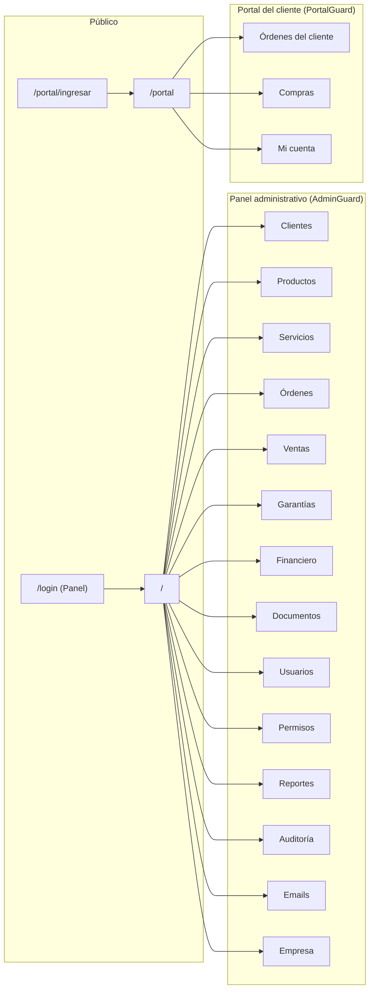

# Catálogo de Pantallas — Sistema Taller

| Campo | Valor |
|---|---|
| Proyecto | Sistema Taller (PROJECT-001) |
| Tarea | TASK-0004 — UX/UI Design |
| Autor | AG-006 UX/UI Designer |
| Fecha | 2026-11-05 |
| Versión | 1.0 |
| Fuente de verdad | `docs/requirements/SOURCE_PROMPT.md` (SP) |
| Insumos | `FUNCTIONAL_REQUIREMENTS.md` (RF-001…082), `BUSINESS_RULES.md` (RB-001…036), `USER_STORIES.md` (HU-001…048), `NON_FUNCTIONAL_REQUIREMENTS.md` (RNF-*), `docs/architecture/ARCHITECTURE.md` (rutas y capas) |
| Stack UI | React + TypeScript + Tailwind CSS + shadcn/ui `[Heredada SP]` |
| Idioma | Español `[CONFIRMADA — SP]` |

---

## 1. Objeto y límites de alcance

Este catálogo enumera **todas las pantallas** de "Sistema Taller" (panel administrativo + portal del cliente), conservando los **17 módulos obligatorios de SP** con su numeración y nombres originales. No se agrega, fusiona ni renombra ningún módulo ni se inventan pantallas fuera de los procesos descritos en SP. Las decisiones de detalle de UX están etiquetadas:

| Etiqueta | Significado |
|---|---|
| `[Heredada]` | Impuesta por SP / RF / RB / HU aprobados |
| `[Inferida]` | Detalle no especificado; opción más simple y consistente (SP, párrafo final) |
| `[Escalado]` | Brecha heredada de arquitectura (E-01…E-09, `ARCHITECTURE.md` §16) que condiciona la pantalla |

Rutas por módulo alineadas con `ARCHITECTURE.md` §6.2; guardas (`AdminGuard`, `PermisoGuard`, `PortalGuard`) por `ADR-002…006`. Formatos obligatorios en toda pantalla: fechas `dd/mm/aaaa` y valores con 2 decimales (RB-007/RB-008).

---

## 2. Convenciones transversales de las pantallas

| # | Convención | Satisface |
|---|---|---|
| C-1 | Todo listado usa el patrón **FiltroBar + DataTablePaginado + acciones por fila** (especificación en `UX_SPEC.md` §5). | RB-007, RNF-U-03 |
| C-2 | Toda alta/edición se abre en **modal** (maestros simples: servicios, garantías, categorías, cuentas, marcas, permisos) o en **página de ficha** (entidades con sub-recursos: clientes, órdenes, ventas, usuarios, permisos). | SP §DISEÑO (modales) |
| C-3 | Toda eliminación pide **ConfirmDialog** en español; si la FK es RESTRICT el backend devuelve el error y la UI lo muestra como toast (RB-022). | RB-022, RB-009 |
| C-4 | Acciones sin permiso se **ocultan** con `PermissionGate`; ocultar no autoriza (verificación real en RLS/RPC). | RB-006, ADR-006 |
| C-5 | Fechas `dd/mm/aaaa`, importes con 2 decimales y símbolo configurable (por defecto R$). | RB-007, RB-008, E-06 |
| C-6 | Toda acción relevante muestra **estado de carga (skeleton/spinner), vacío y error** con mensajes en español (RNF-U-02). | RNF-U-02 |
| C-7 | Toda pantalla privada del panel exige sesión administrativa; el menú lateral solo lista módulos con `v<código>`. | RF-009, RB-035 |
| C-8 | Impresiones (orden, venta, garantía, reportes, portal) usan el **motor PDF único** con encabezado de empresa. | RB-005, RF-065, RF-082 |

---

## 3. Mapa de navegación (vista general)

El menú lateral del panel se construye filtrando el registro de módulos por el código `v<Módulo>` del usuario (RF-009, HU-001 CA1). El cliente del portal **jamás** observa menú administrativo (RB-032).

---

## 4. Catálogo — Panel administrativo

### M1 — Autenticación administrativa

#### SC-01 · Pantalla de ingreso — `/login`

| Atributo | Contenido |
|---|---|
| Permiso | Pública `[Heredada RF-001]` |
| Propósito | Identificar a un usuario administrativo con correo + contraseña |
| Componentes | Card centrado; logo de empresa (si `empresa.url_logo`); campos «Correo electrónico», «Contraseña» (type=password con toggle mostrar); Checkbox «Recordar sesión»; botón primario «Entrar»; enlace «Portal del cliente →» |
| Comportamiento | Validación requerido/formato correo en cliente; error genérico «Credenciales inválidas» (sin revelar existencia del correo, HU-001 CA2) y casos específicos «Su usuario está inactivo.», «Su usuario está expirado.» (RB-023/RB-024); al entrar → `/`; sesión persistente hasta expiración (RF-003); guarda fila en `sesiones` tipo `administrador` (RF-005, HU-003) |
| Estados | carga (spinner en botón), error (alerta bajo contraseña), éxito (redirección) |
| Trazabilidad | RF-001…006 · HU-001…003 · RB-011/013/023/024 |

#### SC-02 · Cierre de sesión — acción en topbar (no pantalla propia)

| Atributo | Contenido |
|---|---|
| Permiso | Sesión válida |
| Propósito | Invalidar sesión y retornar a `/login` |
| Componentes | Item «Cerrar sesión» en menú del avatar del topbar; confirmación no requerida `[Inferida]` |
| Comportamiento | `auth.signOut()` + `sesion_cerrar()` → `/login` |
| Trazabilidad | RF-003/004 · HU-002 |

### M2 — Panel principal

#### SC-03 · Resumen operativo — `/`

| Atributo | Contenido |
|---|---|
| Permiso | Sesión admin válida; cada bloque respeta `v<Módulo>` (HU-004 CA3) |
| Propósito | Resumen del día: órdenes abiertas, stock bajo, últimas ventas, movimientos pendientes |
| Componentes | Saludo con nombre del usuario conectado; 4 tarjetas bloque: **Órdenes abiertas** (conteo por estado, enlaces), **Productos con stock bajo** (tabla corta `v_stock_alerta` con Badge «Stock bajo»), **Últimas ventas** (5 últimas: fecha, cliente, valor), **Movimientos pendientes** (previsto/atrasado con total, RB-025/026); fila inferior de **accesos rápidos** a módulos permitidos; datos vía RPC `panel_resumen()` |
| Comportamiento | Clic en bloque → listado del módulo con el filtro correspondiente ya aplicado |
| Estados | skeleton por tarjeta; bloque vacío «Sin registros» |
| Trazabilidad | RF-007…009 · HU-004 |

### M3 — Clientes

#### SC-04 · Listado de clientes — `/clientes`

| Atributo | Contenido |
|---|---|
| Permiso | `vCliente`
| Componentes | PageHeader («Clientes» + botón «Nuevo cliente» con `aCliente`); FiltroBar: búsqueda por **nombre / documento / correo** (un campo o selector de criterio `[Inferida]`); DataTablePaginado: columnas Nombre, Documento, Teléfono(s), Correo, Ciudad, Fecha de registro (dd/mm/aaaa); acciones por fila: Ver (`vCliente`), Editar (`eCliente`), Eliminar (`dCliente`) |
| Comportamiento | búsqueda server-side paginada; eliminar → ConfirmDialog; si tiene vínculos (órdenes/ventas/movimientos/equipos) → toast con mensaje de rechazo (RB-022, HU-005 CA2) |
| Trazabilidad | RF-010…012 · HU-005…006 |

#### SC-05 · Ficha de cliente — `/clientes/:id`

| Atributo | Contenido |
|---|---|
| Permiso | `vCliente` (editar solo con `eCliente`) |
| Componentes | PageHeader con nombre del cliente; **sección Datos**: formulario (Nombre, Sexo, Persona física (switch), Documento, Teléfono, Celular, Correo, Calle/Número/Barrio/Ciudad/Estado (provincia)/Código postal; `fecha_registro` automática, solo lectura); **tabs vinculadas** (HU-007 CA1): «Órdenes», «Ventas», «Movimientos financieros», «Garantías» (vía `garantia_id` de sus órdenes), cada una mini-tabla paginada filtrada por el cliente con enlace a la ficha respectiva; **tab «Equipos»** (HU-008): equipos del cliente (equipo, marca, modelo, serie, color, tensión, potencia, voltaje, fecha de fabricación dd/mm/aaaa) con alta/edición en modal y **alta de marca en línea** (`marcas`, activa por defecto, sin pantalla extra — HU-008 CA1, E-04) |
| Comportamiento | guardar → validación zod → toast «Cliente guardado.»; auditar (RB-009); volver → listado |
| Trazabilidad | RF-013/014 · HU-007…008 · E-04 |

### M4 — Productos

#### SC-06 · Listado de productos — `/productos`

| Atributo | Contenido |
|---|---|
| Permiso | `vProducto` |
| Componentes | PageHeader («Productos» + «Nuevo producto» con `aProducto`); FiltroBar: búsqueda por descripción + filtro «Solo stock bajo» (Badge contenedor); DataTablePaginado: Descripción, Unidad, Precio de compra (2 dec.), Precio de venta (2 dec.), Stock, Stock mínimo, Entrada/Salida (badges); **fila con stock < mínimo resaltada + Badge «Stock bajo»** (RF-016, HU-011) |
| Comportamiento | eliminar → ConfirmDialog (RESTRICT si tiene líneas asociadas) |
| Trazabilidad | RF-015…018 · HU-009…011 |

#### SC-07 · Ficha de producto — `/productos/:id` (o modal según ancho `[Inferida]`)

| Atributo | Contenido |
|---|---|
| Permiso | `vProducto` / `aProducto` / `eProducto` |
| Componentes | Formulario: Descripción*, Unidad*, Precio de compra*, Precio de venta* (CampoMoneda), Stock* (numérico), Stock mínimo* (numérico), Switches «Salida» (utilizable en órdenes/ventas, E-07) y «Entrada»; nota informativa: *«El stock se descuenta/incrementa automáticamente al agregar o quitar el producto de una orden o venta.» |
| Comportamiento | validación ≥ 0 (RB-020); guardar → toast + invalidar `productos` y `panel` |
| Trazabilidad | RF-015…018 · RB-020 · E-07 |

### M5 — Servicios

#### SC-08 · Listado + modal de servicios — `/servicios`

| Atributo | Contenido |
|---|---|
| Permiso | `vServicio` (+ a/e/d) |
| Componentes | patrón C-1; columnas: Nombre, Descripción, Precio (2 dec.); ModalFormulario «Servicio»: Nombre*, Descripción, Precio* (CampoMoneda) |
| Trazabilidad | RF-019 · HU-012 |

### M6 — Órdenes de trabajo

#### SC-09 · Listado de órdenes — `/ordenes`

| Atributo | Contenido |
|---|---|
| Permiso | `vOrden` |
| Componentes | PageHeader («Órdenes de trabajo» + «Nueva orden» con `aOrden`); FiltroBar: cliente (autocompletado), estado (Chips o Select de los 6: **Presupuesto, Abierta, En Proceso, Finalizado, Cancelado, Aguardando Piezas**), rango fechas inicial, «Solo no facturadas»; DataTablePaginado: Nº, Fecha inicial (dd/mm/aaaa), Fecha final, Cliente, Estado (Badge con color por estado — `UX_SPEC.md` §4), Valor total (2 dec.), Facturada (Badge); acciones: Ver, Editar (`eOrden`), Eliminar (`dOrden`), Imprimir, «Enviar por correo» (RF-026) |
| Trazabilidad | RF-020/021 · HU-013 |

#### SC-10 · Ficha de orden — `/ordenes/:id` *(pantalla más compleja del sistema)*

| Atributo | Contenido |
|---|---|
| Permiso | `vOrden` (mutaciones por código) |
| Componentes | **Cabecera**: Nº orden + Selector de estado (los 6 literales SP; al pasar a «Finalizado» se sugiere `fecha_final` `[Inferida RF-021]`); Cliente (Autocomplete `busqueda_clientes`), Usuario/técnico (Autocomplete `busqueda_usuarios`), Término de garantía (Autocomplete sobre `garantias`, selecciona `garantia_id`), Texto de garantía declarada (`garantia`), Fechas inicial/final (CampoFecha); Descripción del producto, Defecto, Observaciones, Laudo técnico (TextArea); **tab «Productos»**: tabla líneas (Descripción, Cantidad, Precio, Subtotal) + «Agregar producto» (Autocomplete `busqueda_productos` filtrando `salida=true`, E-07; cantidad; estado `Aguardando Piezas` disponible si falta stock — E-01); agregar/quitar/cambiar cantidad invoca RPC y **ajusta stock automáticamente** (RB-002/017/018 — la UI nunca escribe `stock`); **tab «Servicios»**: líneas equivalentes sin stock; **tab «Equipos»**: equipos del cliente asignados a la orden con defecto declarado/encontrado y solución (RF-031, E-04); **tab «Anexos»**: SubirArchivo con miniatura, descarga con URL firmada (RF-025/050/052); **Pie**: Valor total calculado en BD (solo lectura), `facturado` (Badge) |
| Acciones finales | **Facturar** (modal: forma de pago, vencimiento, categoría, cuenta → RPC `orden_facturar`; si ya facturada → toast «La orden ya fue facturada.» RB-003); **Enviar por correo** (modal: destinatario preseleccionado = correo del cliente, editable → encola `pendiente`, RF-026); **Imprimir** → `/ordenes/:id/imprimir` |
| Trazabilidad | RF-020…031 · HU-013…021 · RB-002/003/017/018/021 · E-01 |

#### SC-11 · Impresión de orden — `/ordenes/:id/imprimir`

| Atributo | Contenido |
|---|---|
| Permiso | `vOrden` |
| Componentes | Vista previa PDF (iframe) con encabezado de empresa (logo/nombre/CNPJ/IE/dirección/contacto — RB-005/RF-082), datos de la orden, líneas tabuladas, totales y texto de garantía; botones «Descargar PDF» y «Volver» |
| Trazabilidad | RF-031 · RB-005 |

### M7 — Ventas

#### SC-12 · Listado de ventas — `/ventas`

| Atributo | Contenido |
|---|---|
| Permiso | `vVenta` |
| Componentes | patrón C-1; FiltroBar: cliente (autocompletado), rango `fecha_venta`, «Solo no facturadas»; columnas: Nº, Fecha (dd/mm/aaaa), Cliente, Valor total (2 dec.), Descuento, Facturada (Badge); acciones: Ver, Editar, Eliminar, Imprimir, Facturar (directo con modal) |
| Trazabilidad | RF-032/033 · HU-022 |

#### SC-13 · Ficha de venta — `/ventas/:id`

| Atributo | Contenido |
|---|---|
| Permiso | `vVenta` / `eVenta` |
| Componentes | Formulario: Cliente (Autocomplete), Fecha de venta (CampoFecha), Usuario (sesión, solo lectura `[Inferida]`); **items**: tabla (Descripción, Cantidad, Precio, Subtotal) + «Agregar item» (Autocomplete `busqueda_productos`, `salida=true`, con control de stock RB-002 — idéntico a orden); Descuento (CampoMoneda) y **Valor total recalculado por BD** (solo lectura); acciones: Facturar (modal financiero, `venta_facturar`; única vez, RB-004), Imprimir → `/ventas/:id/imprimir` |
| Trazabilidad | RF-034…037 · HU-023 · RB-002/004/019 |

#### SC-14 · Impresión de venta — `/ventas/:id/imprimir`

| Atributo | Contenido |
|---|---|
| Permiso | `vVenta` |
| Componentes | PDF con encabezado de empresa, items, descuento y total |
| Trazabilidad | RF-036 · RB-005 |

### M8 — Garantías

#### SC-15 · Listado + modal de garantías + impresión — `/garantias`, `/garantias/:id/imprimir`

| Atributo | Contenido |
|---|---|
| Permiso | `vGarantia` (+ a/e/d) |
| Componentes | Listado: Referencia, Fecha (dd/mm/aaaa), creada por (usuario), Texto (recorte); ModalGarantía: Referencia*, Fecha de garantía* (CampoFecha), Texto de garantía* (TextArea larga); Acción imprimir → PDF del término con encabezado de empresa (RF-040); las garantías se asocian a órdenes desde la ficha de orden (Autocomplete de garantías, RF-039) |
| Trazabilidad | RF-038…040 · HU-025…026 |

### M9 — Financiero

#### SC-16 · Flujo de movimientos — `/financiero`

| Atributo | Contenido |
|---|---|
| Permiso | `vMovimiento` (+ a/e/d) |
| Componentes | PageHeader («Financiero») + pestañas «Movimientos» / «Categorías» / «Cuentas» (sub-recursos, E-04); **FiltroBar**: Tipo (Todos / Ingreso / Egreso), **Período: Todos / Día / Semana / Mes / Año** + rango manual `[Heredada RF-043]`, **Situación: Todos / Previsto / Atrasado / Realizado / Pendiente** (RB-025/026), Cliente/Proveedor, Categoría, Cuenta; **barra de totales del período**: Ingresos, Egresos, Saldo (2 dec., RF-045); DataTablePaginado: Vencimiento (dd/mm/aaaa), Pago, Descripción, Tipo (badge verde/rojo), Valor, Situación (badge; vencidos destacados — RF-046), Cliente/Proveedor, Categoría, Cuenta, Forma de pago, Anexo (icono si existe); acciones: Editar, Eliminar, **Marcar pagado** (solo pendientes/atrasados: pide/usa fecha de pago, RB-014) |
| Comportamiento | los movimientos llegados de facturación de orden/venta muestran vínculo «Orden #» / «Venta #» (RF-047); anexo editable con enlace firmado |
| Trazabilidad | RF-041…048 · HU-027…029 |

#### SC-17 · Modales de categorías, cuentas y movimientos — `/financiero` (modal)

| Atributo | Contenido |
|---|---|
| Permiso | `a/eMovimiento`, `a/e de categorías y cuentas` `[Inferida]` |
| Componentes | ModalMovimiento: Descripción*, Tipo* (ingreso/egreso), Valor* (> 0, CampoMoneda), Vencimiento*, Fecha de pago, Pagado (switch — si activo exige fecha de pago, RB-014), Cliente/Proveedor*, Cliente (Autocomplete opcional), Categoría (Select), Cuenta (Select), Forma de pago, Anexo (SubirArchivo a bucket `comprobantes`). ModalCategoría: Categoría*, Tipo*, Estado (switch). ModalCuenta: Cuenta*, Banco, Número, Tipo, Saldo, Estado |
| Trazabilidad | RF-041/042 · RB-014/019/020 · E-04 |

### M10 — Archivos/Documentos

#### SC-18 · Listado de documentos — `/documentos`

| Atributo | Contenido |
|---|---|
| Permiso | `vArchivo` (+ a/e/d) |
| Componentes | PageHeader «Documentos» + «Subir documento»; FiltroBar: búsqueda por nombre, categoría (Select con sugerencias `DISTINCT`, E-04), tipo; DataTablePaginado: Documento, Descripción, Categoría, Tipo, Tamaño (etiqueta UI «Tamaño», columna física `tamanio`), Fecha de registro (dd/mm/aaaa); acciones: Descargar (URL firmada regenerada, RF-052), Editar, Eliminar |
| Modal | Nombre/Documento*, Descripción, Categoría (texto con sugerencias), Tipo (texto), SubirArchivo (valida tamaño — 20 MB por defecto, límite configurable `[Inferida]`, sanitiza nombre RB-034) |
| Trazabilidad | RF-049…053 · HU-030…031 |

### M11 — Usuarios

#### SC-19 · Listado de usuarios — `/usuarios`

| Atributo | Contenido |
|---|---|
| Permiso | `vUsuario` |
| Componentes | patrón C-1; columnas: Nombre, Correo, Grupo de permisos, Estado (Badge Activo/Inactivo), Fecha de registro (dd/mm/aaaa), Fecha de expiración (dd/mm/aaaa, roja si vencida) |
| Trazabilidad | RF-054 · HU-032 |

#### SC-20 · Ficha de usuario — `/usuarios/:id`

| Atributo | Contenido |
|---|---|
| Permiso | `vUsuario` (a/e/d) |
| Componentes | Formulario: Nombre*, RG, CPF, dirección (Calle, Número, Barrio, Ciudad, Estado(provincia)), Correo* (único), Teléfono, Celular, Contraseña (solo en alta/cambio; jamás se re-muestra — HU-001 CA3 análogo, RF-002), Estado (switch «Activo» label «Estado (activo/inactivo)» para no confundir con provincia — ADR-017), **Grupo de permisos** (Select de `permisos` con estado=true, HU-011 análogo RF-058), Fecha de expiración (CampoFecha opcional) |
| Comportamiento | alta/edición invoca EF `admin-usuarios` (identidad Auth + propagación de códigos al JWT, ADR-003/006); baja lógica = `estado=false` (no física `[Inferida RB-022]`) |
| Trazabilidad | RF-054…058 · HU-032…033 · RB-022/023 |

### M12 — Permisos

#### SC-21 · Listado de grupos — `/permisos`

| Atributo | Contenido |
|---|---|
| Permiso | `vPermiso` |
| Componentes | patrón C-1; columnas: Nombre, Estado (Badge), Fecha de creación (dd/mm/aaaa), Cantidad de códigos `[Inferida]`; acciones: Ver/Editar (`ePermiso`), Desactivar (switch, RF-061), Eliminar (`dPermiso`, RESTRICT si hay usuarios del grupo — RB-022) |
| Trazabilidad | RF-059 · HU-034 |

#### SC-22 · Editor de grupo de permisos — `/permisos/:id`

| Atributo | Contenido |
|---|---|
| Permiso | `vPermiso` / `aPermiso` / `ePermiso` |
| Componentes | Nombre*, Estado (switch); **matriz de checkboxes**: filas = 14 módulos cubiertos SP (Cliente, Producto, Servicio, Orden, Venta, Garantía, Movimiento, Archivo, Usuario, Permiso, Respaldo, Auditoría, Email, Empresa) × columnas = actividades **a/e/d/v/r/c** con leyenda («a=agregar, e=editar, d=eliminar, v=visualizar, r=reporte, c=configuración», RB-029);acción «Todo/ninguno» por fila `[Inferida]`; fila **Respaldo** disponible pero sin pantalla en la UI (E-08 — RF-060 CA3); al guardar se propaga a JWT de los usuarios del grupo (R-3 de arquitectura) |
| Trazabilidad | RF-059…061 · HU-035…036 · RB-029 |

### M13 — Informes/Reportes

#### SC-23 · Hub de reportes — `/reportes`

| Atributo | Contenido |
|---|---|
| Permiso | `rFamilia` (requerido en el generador); el hub lista las familias visibles según `v<código>` del módulo correspondiente `[Inferida]` |
| Componentes | 6 tarjetas: **Clientes, Productos, Servicios, Órdenes, Ventas, Financiero**; cada una con «Reporte rápido (todos los registros)» y «Reporte personalizado» (RF-062/063) |
| Trazabilidad | RF-062 · HU-037 |

#### SC-24 · Generador de reporte — `/reportes/:familia`

| Atributo | Contenido |
|---|---|
| Permiso | `rFamilia` |
| Componentes | Modos: rápido (sin filtros) / personalizado; **filtros por familia** `[Heredada RF-064]`: clientes (fecha registro rango); productos (fecha, precio inicial/final, **stock inicial/final**); servicios (precio inicial/final); órdenes (estado, fechas, cliente); ventas (fechas, cliente); financiero (período, situación, tipo); vista previa PDF (iframe) con encabezado de empresa + columnas etiquetadas en español + paginación «Página N de M» (RF-065, RNF-C-02); botones «Descargar PDF» y «Ver en línea» (RF-066) |
| Comportamiento | datos vía RPC `reporte_obtener` por lotes de 200 filas (RNF-P-02) |
| Trazabilidad | RF-062…066 · HU-038…039 · RB-005 |

### M14 — Auditoría

#### SC-25 · Registro de auditoría — `/auditoria`

| Atributo | Contenido |
|---|---|
| Permiso | `vAuditoria` (limpiar con `dAuditoria` `[Inferida]`) |
| Componentes | FiltroBar: usuario, rango fecha/hora; DataTablePaginado: Usuario, Tarea, Fecha (dd/mm/aaaa), Hora, IP (RB-028 — 5 campos exactos); acciones: **Limpiar logs** (ConfirmDialog: rango u opción «todos» con descarga previa sugerida - RF-069);acciones relevantes insertadas por trigger/RPC, jamás editables (RB-009) |
| Trazabilidad | RF-067…069 · HU-040…041 |

### M15 — Cola de emails

#### SC-26 · Cola de emails — `/emails`

| Atributo | Contenido |
|---|---|
| Permiso | `vEmail` (+ a/d) |
| Componentes | FiltroBar: estado (Chips: pendiente / enviando / enviado / fallido), rango fecha; DataTablePaginado: Para, CC, CCO (recorte), Mensaje, **Estado (Badge con color por estado)**, Intentos (de `encabezados`, solo lectura `[Inferida E-02]`), Fecha (dd/mm/aaaa y hh:mm); acciones: **Procesar cola** (invocación manual del EF, además del cron cada 2 min), **Reintentar** (solo fallidos: `fallido → pendiente`, RF-073), Eliminar (RF-074); Modal «Nuevo email» (aEmail): Para*, CC, CCO, Mensaje*, Encabezados (texto/JSON) |
| Comportamiento | mensajería **asíncrona y no bloqueante** (RNF-A-02); si no hay proveedor configurado, fallidos indican «proveedor no configurado» (`E-02`) |
| Trazabilidad | RF-070…074 · HU-042…043 · RB-015 |

### M17 — Configuración de empresa

#### SC-27 · Formulario de empresa — `/empresa`

| Atributo | Contenido |
|---|---|
| Permiso | `cEmpresa` / `eEmpresa` `[Ver tabla arquitectura — SP M17]` |
| Componentes | Formulario único (registro único RB-030, si no existe se crea): Nombre*, CNPJ, IE, dirección (Calle, Número, Barrio, Ciudad, Provincia), Teléfono, Correo, **Subir logo** (vista previa, bucket `logos`, usado en PDFs — RF-082/RB-005); nota: *«El logo aparece en los encabezados de reportes e impresiones.»* |
| Trazabilidad | RF-081/082 · HU-047…048 · RB-030 |

---

## 5. Catálogo — Portal del cliente (M16)

Árbol de aplicación independiente (`PortalLayout`), sin menú administrativo, UI simplificada orientada a lectura (RB-032, RF-075…080).

#### SC-P1 · Ingreso al portal — `/portal/ingresar`

| Atributo | Contenido |
|---|---|
| Permiso | Pública (rol cliente) |
| Componentes | Card centrado: logo empresa; campos **Correo electrónico** y **Documento** (RF-075, RB-012); botón «Ingresar»; enlace «¿Administrador? Acceder al panel →”; error genérico «Correo o documento no coinciden con ningún cliente registrado.» (sin revelar existencia, recomendación de arquitectura §9.1) |
| Trazabilidad | RF-075 · HU-044 · RB-012 |

#### SC-P2 · Panel del cliente — `/portal`

| Atributo | Contenido |
|---|---|
| Permiso | sesión `rol='cliente'` |
| Componentes | Saludo con el nombre del cliente; **tarjetas «Mis últimas órdenes»** (Nº, fecha, estado en badge, valor) y **«Mis últimas compras»** (fecha, valor, «Facturada» Sí/No `[Inferida]`); acceso a «Ver detalle» y «Imprimir» de cada ítem (RF-076/077/078); topbar con «Mi cuenta» y «Cerrar sesión» (RF-080) |
| Trazabilidad | RF-076 · HU-044 |

#### SC-P3 · Detalle de orden (portal) — `/portal/ordenes/:id`

| Atributo | Contenido |
|---|---|
| Permiso | propietario del registro (RLS `cliente_id = cliente_actual()` — RB-032) |
| Componentes | Solo lectura: datos de la orden, técnico, estado, descripción/defecto/laudo, líneas de productos y servicios con subtotales, valor total, texto/grado de garantía, anexos descargables; botón «Imprimir» (PDF con datos de la empresa — ver SC-14; intento de acceso a orden ajena queda bloqueado por RLS y se muestra mensaje genérico) |
| Trazabilidad | RF-077 · HU-044…045 |

#### SC-P4 · Detalle de compra (portal) — `/portal/compras/:id`

| Atributo | Contenido |
|---|---|
| Permiso | propietario (RLS) |
| Componentes | Solo lectura: fecha, items con subtotales, descuento, valor total; botón «Imprimir» |
| Trazabilidad | RF-078 · HU-045 |

#### SC-P5 · Mi cuenta — `/portal/cuenta`

| Atributo | Contenido |
|---|---|
| Permiso | propietario |
| Componentes | Formulario con los campos personales del cliente pre-cargados (nombre, teléfonos, dirección); **correo y documento en solo lectura** con nota «Para cambiar su correo o documento, contacte al taller.» (E-05, RF-079 CA4); guardar → `cliente_actualizar_cuenta` + toast |
| Trazabilidad | RF-079 · HU-046 · E-05 |

#### SC-P6 · Cerrar sesión — acción de topbar

| Atributo | Contenido |
|---|---|
| Comportamiento | ídem SC-02 → `/portal/ingresar` |
| Trazabilidad | RF-080 · HU-046 |

---

## 6. Estados de pantalla y estados de acción (resumen operativo)

| Pantalla | Estados de implementación obligatorios |
|---|---|
| Todos los listados | carga (skeleton en tabla), vacío (EmptyState en español), error (ErrorState + reintentar), paginación server-side |
| Todos los modales | apertura con foco, validación inline (zod), guardado (spinner), error (toast + campo), cierre por ESC/X |
| Órdenes / Ventas ficha | bloqueo temporal durante RPC de líneas/facturar (evitar doble clic); errores de stock E-01 como toast + inline |
| Portal | mismo estándar, con datos restringidos por RLS; cero enlaces a módulos admin |

## 7. Trazabilidad de cobertura (resumen)

| Módulo SP (nombre y numeración originales) | Pantallas |
|---|---|
| M1 Autenticación administrativa | SC-01, SC-02 |
| M2 Panel principal | SC-03 |
| M3 Clientes | SC-04, SC-05 |
| M4 Productos | SC-06, SC-07 |
| M5 Servicios | SC-08 |
| M6 Órdenes de trabajo | SC-09, SC-10, SC-11 |
| M7 Ventas | SC-12, SC-13, SC-14 |
| M8 Garantías | SC-15 |
| M9 Financiero | SC-16, SC-17 |
| M10 Archivos/Documentos | SC-18 |
| M11 Usuarios | SC-19, SC-20 |
| M12 Permisos | SC-21, SC-22 |
| M13 Informes/Reportes | SC-23, SC-24 |
| M14 Auditoría | SC-25 |
| M15 Cola de emails | SC-26 |
| M16 Portal del cliente | SC-P1…SC-P6 |
| M17 Configuración de empresa | SC-27 |

**Cobertura: 17/17 módulos, 33 pantallas, sin módulos nuevos.** Detalle de componentes, tokens y patrones en `UX_SPEC.md`.

## 8. Puntos condicionados a escalamientos heredados (heredados de `ARCHITECTURE.md` §16)

| Pantalla | Condición | Efecto en UX |
|---|---|---|
| SC-10 / SC-13 | E-01 (stock insuficiente bloquea) | Mensaje «Stock insuficiente. Disponible: X.»; estado «Aguardando Piezas» visible como salida |
| SC-10, SC-26 | E-02 (proveedor de email agnóstico) | Modo simulado → estados `fallido` con «proveedor no configurado» |
| SC-05 | E-04 (equipos/marcas como sub-recursos) | Pestañas «Equipos» integradas, no módulos extra |
| SC-P5 | E-05 (correo/documento no editables) | Campos de solo lectura + contacto |
| SC-07 | E-07 (salida/entrada) | Switches con explicación de uso |
| SC-21/22 | E-08 (Respaldo, sesiones) | Código Respaldo disponible en editor; sin pantalla |
